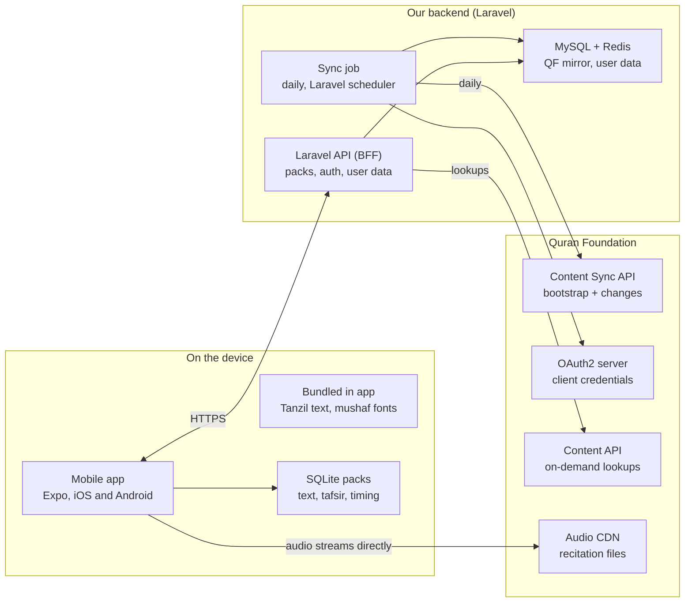

# Quran App — Content Production Plan

Oct 26, 2026 · Eyad Alasfahani

## Goals & constraints

Production content must open instantly, work offline, never alter a letter of the Quran, and stay inside Quran Foundation's licence. Those four constraints drive every decision below.

- **Text integrity:** Quran text, translations and tafsir are rendered exactly as received. No hand edits, no reflowing that changes meaning, no re-encoding.
- **Offline-first:** reading, the last-used reciter's downloaded surahs and the user's bookmarks work with no network.
- **Licence-compliant:** offline copies of QF content come only through QF Content Sync and are refreshed at least every 7 days. A build-time database of QF content may not be shipped in the app.
- **Fast:** cold start to last-read ayah under 1.5 s on a mid-range Android; audio starts under 1 s on 4G.
- **User choice of display:** several Quran fonts (scripts) and display modes, with continuous vertical scrolling as the default reading gesture.

**Product decisions:** the app is free with no donations; the interface is Arabic first, with English as the second language; the app is built with Expo, and the backend is Laravel, self-hosted.

## Tech stack & libraries

The app is Expo SDK 58 (React Native 0.88, React 19.3, development builds through EAS) and the backend is Laravel 13 on PHP 8.5. Every version below is the latest stable release as of 26 October 2026, checked against npm and Packagist. For the app, "latest" means the version Expo SDK 58 supports: `npx expo install` picks it, and it can trail npm (Expo pins gesture handler 3.3 while npm has 3.4, and Sentry 8.28 while npm has 8.32).

**Mobile app (Expo)**

| Job | Library | Version | Why |
| --- | --- | --- | --- |
| Platform | Expo SDK, React Native, React | `expo` 58.0.19, `react-native` 0.88.0, `react` 19.3.0 | Current SDK; RN and React exactly as SDK 58 pins them |
| Language | TypeScript | \~6.0.3 | The version in Expo's SDK 58 template; TypeScript 7.0 is out but not yet in Expo's template |
| Navigation | Expo Router | \~58.0.26 | Native tabs and stacks, sheets as routes, deep links |
| Liquid Glass | `expo-glass-effect` | \~58.0.5 | Native iOS 26 glass with automatic fallback |
| Local database | `expo-sqlite` + Drizzle ORM | \~58.0.14; `drizzle-orm` 0.45.4, `drizzle-kit` 0.31.11 | Offline Quran, translation and tafsir packs with typed queries and migrations |
| Long lists | `@shopify/flash-list` | 2.3.2 | Virtualized vertical mushaf and surah lists |
| Audio | `expo-audio` | \~58.0.10 | Background playback, lock-screen controls and playlists built in |
| Downloads | `expo-file-system` | \~58.0.11 | Audio and pack downloads with progress |
| Server data | `@tanstack/react-query` | 5.105.0 | Caching, retries and background refetch for API calls |
| App state | `zustand` | 5.0.16 | Small global state: player, reader settings |
| Preferences | `react-native-mmkv` + `react-native-nitro-modules` | 4.3.2; 0.37.1 | Fast synchronous key-value storage; MMKV 4 runs on Nitro modules |
| Tokens | `expo-secure-store` | \~58.0.2 | Keychain / Keystore storage for the auth token |
| Google sign-in | `@react-native-google-signin/google-signin` | 16.1.5 | Native Google sign-in; ID token sent to Laravel |
| Apple sign-in (iOS) | `expo-apple-authentication` | \~58.0.2 | Native Sign in with Apple; identity token sent to Laravel |
| Languages | `i18next` + `react-i18next` + `expo-localization` | 26.5.11; 17.1.9; \~58.0.5 | Arabic and English strings, device language detection |
| Motion and gestures | `react-native-reanimated` + `react-native-worklets` + `react-native-gesture-handler` | 4.7.1; 0.13.0; \~3.3.0 | Sheets, mini-player to player, ayah and word highlight |
| Notifications | `expo-notifications` | \~58.1.6 | Local reminders and push tokens |
| Prayer times | `adhan` + `expo-location` | 4.4.6; \~58.0.19 | On-device prayer times for "dark mode after Maghrib" and reminders |
| Tafsir rendering | `@native-html/render` | 1.0.4 | Renders sanitized tafsir HTML. Replaces `react-native-render-html`, which has had no release since January 2022 |
| Fonts | `expo-font` | \~58.0.10 | Bundles KFGQPC Quran fonts, Amiri, IBM Plex Sans Arabic |
| Errors | `@sentry/react-native` | \~8.28.0 | Crash and error reporting, at the version SDK 58 pins |
| Updates and builds | `expo-updates`, `eas-cli` | \~58.0.18; 26.0.0 | Over-the-air JavaScript fixes and store builds |
| Development builds | `expo-dev-client` | \~58.0.15 | The EAS development profile; MMKV and other native modules don't run in Expo Go |
| Tests | Jest + `jest-expo` + React Native Testing Library; Maestro | 30.5.2; \~58.0.12; 14.1.0; latest Maestro CLI | Unit and component tests; end-to-end flows on devices |
| Lint | `eslint` + `eslint-config-expo` | 9.39.5; \~58.0.4 | Expo's flat config; ESLint 9 is the line `eslint-config-expo` supports |
| API types | `openapi-typescript` | 7.13.0 | Generates the TypeScript types in `packages/api-contract` from `openapi.json`. Its peer is `typescript ^5`, so npm nests TS 5.9.3 for it; the repo stays on TS 6 |

**Backend (Laravel)**

| Job | Library | Version | Why |
| --- | --- | --- | --- |
| Runtime | PHP | 8.5 (8.5.12) | Newest branch, active support to the end of 2027; Pest 5 needs 8.4 or newer |
| Framework | `laravel/framework` | 13.38.0 | Current major |
| API auth | `laravel/sanctum` | 4.3.3 | Token auth for the mobile app |
| Google sign-in | `google/apiclient` | 2.20.1 | Verifies the Google ID token from the app |
| Apple sign-in | `firebase/php-jwt` | 7.2.1 | Verifies Apple identity tokens; signs the client secret for token revocation |
| Queues | Redis + `laravel/horizon` | 8.10; 5.50.1 | Content sync, emails, push sends, with a dashboard |
| Redis client | `predis/predis` | 3.7.0 | Pure-PHP Redis client; no `phpredis` extension needed on the Mac or in the image |
| Scheduled jobs | Laravel scheduler | Built in | Daily Quran Foundation and hadith sync, reminder sends |
| Push | Expo Push API through a queued custom notification channel | HTTP API | One endpoint for iOS and Android push; no extra dependency |
| Admin | `filament/filament` | 5.10.3 | Daily hadith rotation, content sources, user support |
| Data objects | `spatie/laravel-data` | 4.23.1 | Typed values between layers; responses are API Resources (ADR 0006) |
| Backups | `spatie/laravel-backup` | 10.3.3 | Database backups to off-site storage |
| Monitoring | `laravel/pulse` + `sentry/sentry-laravel` | 1.8.1; 4.29.0 | Performance, slow queries, errors |
| Quality | Pest, Larastan, Pint | 5.3.0; 3.13.2; 1.32.1 | Tests, static analysis, code style. Pest 5.3.3 needs PHPUnit 13.4.3, which Composer blocks for security advisory PKSA-qhjm-rpqc-qkn6, so Pest stays on 5.3.0 (PHPUnit 13.3.6) until a fixed pair ships |
| AI tooling (dev) | `laravel/boost` | 2.10.3 | Agent guidelines, skills and an MCP server with docs search, schema and log tools |
| API contract | `dedoc/scramble` | 0.13.51 | Generates `openapi.json` from routes, FormRequests and API Resources (the free version can't read Data objects; ADR 0006) |
| Data | MySQL, Redis | 9.7 LTS (9.7.4); 8.10 (8.10.3) | Main database, cache and queues. MySQL 9.7 is the current LTS series |
| Tooling | Node.js | 26 (26.12.1; LTS promotion due late October 2026) | CI, EAS CLI and local builds; pinned in `.nvmrc` |

**Keeping versions current**

- **Start on latest:** create the app with `npx create-expo-app` (SDK 58 template) and add every Expo-managed package with `npx expo install`, never `npm install`. Create the backend with the Laravel installer on Laravel 13.
- **Expo SDK upgrades:** Expo ships a new SDK a few times a year. Move to each new SDK within about four weeks of its release, on a branch, with `npx expo install --fix` and `npx expo-doctor`. Expo's pinned versions win over npm's latest.
- **Automated updates:** Renovate opens grouped weekly pull requests for npm and Composer. Patch and minor updates merge automatically when CI passes. Major updates and anything Expo pins are merged by hand.
- **CI guards:** `npx expo-doctor`, `npm outdated` and `composer outdated --direct` run in CI. `composer audit` and `npm audit` fail the build on high-severity issues.
- **Lockfiles:** `package-lock.json` and `composer.lock` are committed. Production installs are reproducible: `npm ci` and `composer install --no-dev`.
- **Laravel and PHP:** move to each Laravel major within two months of release, once Filament and Spatie packages support it. Take PHP minors once Laravel supports them. Docker images pin the minor version (`php:8.5-fpm`, `mysql:9.7`, `redis:8.10`) and are rebuilt monthly for patches.
- **No abandoned packages:** a library with no release for 12 months is replaced, as `react-native-render-html` was.

## Content sources & licensing

Quran Foundation (QF) is the primary source, synced through its Content Sync API. Tanzil text is the only Quran text bundled inside the app binary, because QF's terms forbid shipping a prepackaged database of QF content.

| Content | Source | How it reaches the device | Licence rule that shapes it |
| --- | --- | --- | --- |
| Quran text (Uthmani, IndoPak, Tajweed, Imla'i), surah/juz/hizb metadata | QF Content Sync `quran_core` | Synced after install; refreshed at least every 7 days | Offline copies only via Content Sync; no build-time bundle ([terms](https://api-docs.quran.foundation/legal/developer-terms/)) |
| Mushaf page layouts and word positions | QF Content Sync `mushafs` | Synced | Same as above |
| Translations, word-by-word, tafsir | QF Content Sync `translations`, `tafsirs` | Synced per language the user picks | Displayed unmodified, in original context |
| Recitation audio + verse/word timing | QF Content Sync `chapter_recitations` | Timing synced; audio streamed or downloaded per surah | Audio is QF content; offline download rules to confirm with QF |
| Mushaf fonts (KFGQPC, QCF page fonts, IndoPak) | QF font files | Bundled in the app binary | Allowed only inside the app, with an active Developer Console account and visible QF credit ([fonts terms](https://api-docs.quran.com/legal/mushaf-fonts-and-images/)) |
| Fallback Quran text for first launch with no network | [Tanzil](https://tanzil.net/docs/text_license) Uthmani text | Bundled in the app binary | CC BY 3.0, verbatim copies only, credit and link to tanzil.net |

Monetization is allowed without a separate licence (paid app, subscriptions, ads, donations) as long as QF content is only shown to end users and never resold or exposed as a dataset or API. Training ML models on QF content needs written consent.

## API catalog

This lists every external source the app could pull from, and which one we use for each kind of content. The app talks only to our backend and to the audio CDNs. Laravel pulls from each provider on a schedule, stores the source and version with every record, and serves the result to the app. A source marked **Later** goes live only once its terms are confirmed or written permission is on file.

**Quran text, layouts, translations and tafsir**

| API | Gives us | Access | Terms that matter | Decision |
| --- | --- | --- | --- | --- |
| [Quran Foundation](https://api-docs.quran.foundation/) Content API v4 + Content Sync | Text in every script, mushaf layouts, word-by-word, translations, tafsir, recitations with ayah and word timing | OAuth2 client credentials; prelive and production keys | No prepackaged bundle; re-sync at least every 7 days; credit QF | **Primary** for all Quran content |
| QF User APIs + OAuth2 login | Bookmarks, collections, notes, reading progress, goals and preferences on a Quran.com account | User signs in with Quran.com | User data lives in Quran.com accounts | **Not used**: our own accounts and sync keep data in-house; a "connect Quran.com" option could come later |
| [Tanzil](https://tanzil.net/docs/text_license) | Uthmani and simple text, surah metadata | File download, no API | CC BY 3.0; verbatim only; credit and link | **Fallback**, bundled for first launch |
| [QuranEnc](https://quranenc.com/en/home/api/) API v1 | Reviewed translations with footnotes, tafsir, recited audio for 13 translations; a version and last-update date per translation | No key | No changes; credit QuranEnc and show the version; keep to the latest version; no inappropriate ads | **Later**: translations QF lacks, with a weekly version check |
| [QUL by Tarteel](https://qul.tarteel.ai/faq) | Downloadable scripts, fonts, layouts, word-by-word, tafsir, similar ayahs (mutashabihat), surah info, topics, grammar data | Downloads only; no API yet | Licence differs per resource; many allow commercial use | **Later**: similar ayahs and topics, after checking each resource's licence |
| [AlQuran Cloud](https://alquran.cloud/terms-and-conditions) | Text and many editions, per-ayah audio CDN | No key; soft per-IP limit | Credit Tanzil and translators; recitations for personal and educational use; reciters keep copyright | **Not used**: overlaps QF |
| [fawazahmed0/quran-api](https://github.com/fawazahmed0/quran-api) | 440+ translations in about 90 languages, static JSON | Public CDN; repo under Unlicense | Some translations are OCR'd; translators' rights not cleared per edition | **Not used** |
| [islamic.app](https://docs.islamic.app/llms.txt) | Quran.com-v4-compatible Quran, hadith, prayer times, duas, masajid | No key; 600 requests a minute per IP | Operator and terms not published | **Not used** |

**Recitation audio**

| API | Gives us | Access | Terms that matter | Decision |
| --- | --- | --- | --- | --- |
| QF chapter recitations | Per-surah audio with ayah and word timing | Through QF | QF terms; keeping downloads past 7 days is an open question | **Primary** |
| [MP3Quran](https://www.mp3quran.net/eng/api) API v3 | Large reciter catalogue across riwayat, live Quran radio, audio tafsir, ayah timing for some readings | No key | No API terms published | **Later**: more reciters, other riwayat and radio, after written permission |
| [QuranicAudio](https://www.quranicaudio.com/about) | Per-surah MP3 archive | Direct files | Personal use only; no commercial use | **Not used** directly; we play only the audio links QF gives us, under QF's terms |
| AlQuran Cloud audio CDN | Per-ayah MP3s | No key | As above | **Not used** |

**Hadith** (details in the Hadith section)

| API | Gives us | Access | Terms that matter | Decision |
| --- | --- | --- | --- | --- |
| [HadeethEnc](https://documenter.getpostman.com/view/5211979/TVev3j7q) API v1 | Curated hadiths with grade, explanation and benefits, by category; 72 languages | No key | No changes; credit HadeethEnc | **Primary** for v1 |
| [Sunnah.com](https://sunnah.com/developers) | Full collections, Arabic and English | API key by GitHub request | Not published; confirm before building | **Later**: v2 |
| [fawazahmed0/hadith-api](https://github.com/fawazahmed0/hadith-api) | Collections with grades, static JSON | Public CDN | Grade sources not documented | **Not used** |
| Dorar.net | Arabic grading and takhrij | No official public API | Unofficial packages read the site | **Not used** without permission |

**Adhkar and duas**

| API | Gives us | Access | Terms that matter | Decision |
| --- | --- | --- | --- | --- |
| [Hisn al-Muslim](https://github.com/alihmada/Islamic-APIs) JSON (hisnmuslim.com) | Hisn al-Muslim adhkar as static JSON by category | No key | No terms published | **Later**: morning and evening adhkar, after permission |
| [Islamic Network](https://islamic.network/api/) Pray API | Duas and adhkar linked to Hijri months and blessed days | No key; early access | Early access | **Watch** |

**Prayer times, Hijri date and qibla**

The Settings design already has "dark mode after Maghrib", and reminders may follow prayer times, so the app needs prayer times even without a prayer-times feature.

| API | Gives us | Access | Terms that matter | Decision |
| --- | --- | --- | --- | --- |
| [adhan](https://github.com/batoulapps/adhan-js) (npm library) | Prayer times by standard calculation methods, qibla direction, last third of the night | Runs on the device; no network | MIT | **Primary**: computed on the device from `expo-location` |
| [AlAdhan](https://aladhan.com/prayer-times-api) API | Prayer times, monthly calendars, Hijri and Gregorian conversion, qibla, Asma al-Husna | No key; free; asks clients to cache | No warranty; times may differ from local standards | **Primary** for the Hijri date and Asma al-Husna, pulled by the backend daily |

**Rules for every provider**

- **One adapter per provider:** each sits behind a `ContentSource` interface in Laravel (fetch, check version, normalize). Adding or dropping a provider never touches the app.
- **Provenance on every record:** source, source key, source version and fetch time. A `content_sources` table holds each provider's licence text, attribution line and permission status.
- **Polite fetching:** cache, use conditional requests where supported, back off on 429, and send a User-Agent with the app name and a contact email.
- **Credits:** the Sources & thanks screen is generated from `content_sources`, so every provider in use is credited.

**Permissions to request**

- [ ] QuranEnc: confirm app use and offline storage of translations
- [ ] MP3Quran: permission to stream reciters and radio in the app
- [ ] Hisn al-Muslim: permission to show the adhkar
- [ ] HadeethEnc: confirm app use in writing
- [ ] Sunnah.com: API key and terms

## Architecture

The app talks only to our Laravel API, which is the single holder of QF credentials; audio is the one thing the app fetches from QF directly.

The daily sync job keeps the backend mirror current through Content Sync. The app reads its local SQLite packs, pulls changes and user data from our API, and streams recitations straight from QF's CDN.

## Data model & ingestion pipeline

The backend keeps a mirror of QF content through Content Sync, and the app keeps its own on-device copy that is refreshed from the backend on the same 7-day rule.

**Sync cycle (backend, Laravel scheduler, daily)**

1. Request an access token with client credentials (`scope=content`); cache it until shortly before its 1-hour expiry.
2. First run: call `GET /resources/sync?bootstrap=true` for the resource groups we use, fetch every `snapshot_url`, and store the final `next_sync_token`.
3. Later runs: call `/resources/sync` with the stored token and the same `resources` filter; apply mutations in ascending `sequence` order.
4. `RESOURCE_CREATE` / `RESOURCE_INVALIDATE` → fetch the snapshot and replace that resource's rows. `ROW_*` → upsert or delete one row. `RESOURCE_DELETE` → drop the resource.
5. Bump a content version per resource, so devices know what to pull.
6. Alert if any resource has not synced for 5 days, leaving a 2-day buffer before the 7-day limit.

**Device sync (app)**

1. First launch shows the bundled Tanzil text immediately.
2. In the background, the app downloads the content packs for the user's chosen script, mushaf layout and languages from our backend.
3. Every launch with a network, and at least every 7 days, the app asks for changes since its stored version and applies them.

**Core tables (backend MySQL and device SQLite share the same shape)**

| Table | Key | Holds |
| --- | --- | --- |
| `qf_resources` | group + resource id | name, language, version, last synced at |
| `verses` | verse key (e.g. 2:255) | text per script, page, juz, hizb, rub |
| `words` | verse key + position | text per script, line and page position per mushaf |
| `translations` / `tafsirs` | resource id + verse key | text, verse range for tafsir |
| `recitations` | reciter id + surah | audio URL, duration, verse and word timing segments |
| `sync_state` | environment + group | sync token, last sequence |

User data (bookmarks, highlights, notes, khatma and hifz progress) lives in separate backend tables, keyed by user id and verse key, so it survives any content re-sync.

## Audio delivery & ayah/word timing

Audio streams from QF's CDN, and ayah and word highlighting is driven by the timing segments synced with each chapter recitation.

- **Catalogue:** reciters and their recitations come from the synced `chapter_recitations` group, so the reciter list updates without an app release.
- **Playback:** one audio file per surah, with gapless continuation into the next surah. `expo-audio` handles background play, lock-screen controls and playlists; CarPlay and Android Auto are not in v1.
- **Highlighting:** verse-level offsets drive the ayah highlight and the auto-scroll. Word-level segments drive the word highlight in the player and focus mode, only where QF provides them for that reciter.
- **Range repeat and memorization:** seek to an ayah's start offset, loop between two offsets N times, then continue. Timing data makes this work without per-ayah files.
- **Downloads:** per-surah download with progress, a storage view, and "delete all for this reciter". Whether downloaded audio may be kept beyond 7 days without re-sync is an open question for QF.

## Tafsir, translations & word-by-word

All study content comes from Quran Foundation. It is downloaded per resource the reader picks, and shown exactly as received with its author credited. No resource is preinstalled.

| Content | What we offer by default | How the reader gets it | Where it shows |
| --- | --- | --- | --- |
| Short tafsir (Arabic) | Al-Muyassar, suggested on first use | Downloaded as a pack when chosen; online lookup until then | Tafsir sheet, opened from the ayah actions |
| Long tafsir | Ibn Kathir (Arabic; English abridged for English readers) | Download on demand | Same sheet, switched with the tafsir picker |
| Translations | None preselected; suggested by the app language | Pack per translation | Under each ayah in Reading mode; in the ayah sheet |
| Word-by-word meaning and transliteration | The app language | Pack per language | Word chips on tap; Focus mode |

The exact tafsir and translation IDs are confirmed by calling `/resources/tafsirs` and `/resources/translations` with our prelive keys. The names above are what Quran.com offers today, not yet verified against the API.

**How it works**

1. **Catalogue:** the backend syncs the resource lists. The app only offers resources present in our mirror, showing QF's name, author and language fields.
2. **Selection:** the reader picks in Settings or from the tafsir picker. The app downloads that resource's pack from our backend, which keeps it current through the Content Sync `tafsirs` and `translations` groups.
3. **Before download or offline:** the app asks our API for one ayah. The backend calls QF's tafsir-by-ayah endpoint (`resource_id` + `ayah_key`) and caches the answer for no more than 7 days.
4. **Rendering:** tafsir text arrives as HTML. The backend sanitizes it to a short whitelist of tags (paragraphs, line breaks, bold, italic, quote spans) without changing any words, and the app renders it with `@native-html/render` in the interface font, at the reader's chosen size.
5. **Ranges:** one tafsir entry can cover several ayahs. We store its first and last verse key, title it "تفسير الآيات ٢–٥", and show the same entry for every ayah in the range instead of repeating it.
6. **Credit:** the resource and author name sit under every tafsir and translation, and Settings lists every source.
7. **Search:** downloaded translations and tafsirs go into an on-device SQLite FTS5 index for the "translation and tafsir" search filter. Quran text search uses normalized Arabic (no diacritics; alef, hamza and ta marbuta forms unified).
8. **Updates:** Content Sync row changes update the device silently. If QF removes a resource, it is deleted from the device and the reader is told in Settings.

**What we will not do:** summarize, simplify, machine-translate or AI-rewrite any tafsir or translation. The licence requires QF content to be shown unmodified and in context, and using it to train or tune models needs QF's written consent. An AI "explain this ayah" feature would need a separate licence and scholarly review before it is considered.

**Tables added:** `tafsir_entries` (resource id, first and last verse key, sanitized HTML), `translation_entries` (resource id, verse key, text, footnotes), `user_resources` (which packs each reader has chosen, synced with their account).

## Hadith

The Hadith section launches with HadeethEnc's curated hadiths and explanations; full collections from Sunnah.com follow once they grant API access and confirm terms.

| Source | What it gives us | Access | Terms we must follow | Use |
| --- | --- | --- | --- | --- |
| [HadeethEnc.com](https://hadeethenc.com/en/home/about) | Curated, frequently cited hadiths with simplified explanations; Arabic plus about 70 languages | Free API ([docs](https://documenter.getpostman.com/view/5211979/TVev3j7q)) | No modification, addition or deletion; credit HadeethEnc as the source | v1: daily hadith, topics, search, detail |
| [Sunnah.com](https://sunnah.com/developers) | Full collections (Bukhari, Muslim, Abu Dawud, Tirmidhi and others), Arabic and English | API key requested through their GitHub; only part of the data so far; no offline dump yet | Not stated: confirm app use, offline storage and credit before building | v2: browse full collections |
| [fawazahmed0/hadith-api](https://github.com/fawazahmed0/hadith-api) | Collections in many languages with grades, as static JSON | Public CDN, Unlicense | Grade sources are not documented | Not used unless the reviewer approves specific content |
| Dorar.net | Strong Arabic grading and takhrij | No official public API | Unofficial packages read the website | Not used without Dorar's permission |

- **Pipeline:** the backend pulls HadeethEnc categories and hadiths for Arabic and English into MySQL on a schedule; the app downloads them as a small pack and works offline, like the Quran content.
- **Display:** every hadith shows its grade, its source collection and narrator, and a link back to the source page. Explanations are shown in full, never shortened or rewritten.
- **No AI:** no generated explanations, summaries or translations of hadith.
- **Review:** the content reviewer signs off on the Hadith section, including the daily hadith rotation, before launch.
- **Tables:** `hadith_categories`, `hadiths` (source, source id, Arabic text, grade, narrator, collection reference), `hadith_translations` (hadith id, language, text, explanation, benefits).
- **Next steps:** request a Sunnah.com API key now; confirm HadeethEnc's API terms for app use in writing.

## Languages & localization

Arabic is the default interface language and English is the second; Quran text is always right-to-left whatever the interface language.

- **Language choice:** picked on the first onboarding screen from the device language (`expo-localization`), changeable later in Settings.
- **Strings:** every interface string lives in i18next resource files (`ar.json`, `en.json`); no hard-coded text in components. Arabic plural forms are used where counts appear.
- **Direction:** switching between Arabic and English flips the layout with `I18nManager.forceRTL` and reloads the app once (`Updates.reloadAsync`). Media controls and audio progress are never mirrored.
- **Numbers:** Arabic-Indic digits in the Arabic interface, Western digits in English.
- **Content languages are separate:** the interface language does not change the Quran, tafsir or translation the reader chose.
- **Store listings:** App Store and Google Play pages in both Arabic and English.
- **Backend:** API errors and emails come in the user's language, sent as an `Accept-Language` header.

## Accounts & authentication

Accounts are optional and only sync personal data. Sign-in is by email code or Google on both platforms, plus Sign in with Apple on iOS. Reading and listening never require an account.

- **Email code:** the user enters an email, Laravel sends a 6-digit code valid for 10 minutes, and verifying it issues a Sanctum token. Codes are hashed, single-use and rate-limited per email and per IP. Emails go through a transactional email provider, even though the server is self-hosted, so they don't land in spam.
- **Google:** the app signs in natively and sends the Google ID token to Laravel, which verifies it with `google/apiclient` and issues a Sanctum token. Accounts are matched by verified email, so the same person using email and Google gets one account.
- **Apple (iOS only):** required by App Store guideline 4.8 because the app offers Google sign-in. The app uses `expo-apple-authentication` (`ios.usesAppleSignIn: true` in the Expo config) and sends the identity token to Laravel, which verifies it against Apple's public keys with the bundle ID as audience, stores `sub` as the provider ID and issues a Sanctum token. Users who hide their email arrive with a private relay address, so our sending domain must be registered under Sign in with Apple for Email Communication in the Apple Developer account. About 2–3 days of work, inside Foundations.
- **Tokens:** one Sanctum token per device, stored in `expo-secure-store`; a devices list in Account lets the user sign other devices out.
- **Guest data:** bookmarks, highlights, notes and khatma progress made before sign-in are uploaded and merged into the account on first sign-in.
- **Sign out:** keeps local data on the device.
- **Account deletion:** in-app, with a confirm step, deleting all server data. Required by the App Store and Google Play. For Apple accounts, Laravel also revokes the user's Apple token through Apple's `/auth/revoke` endpoint, using a client secret signed with our Sign in with Apple key (.p8).

## User data sync

Personal data is written to the device first and synced in the background; each item is resolved on its own with last-write-wins.

- **What syncs:** bookmarks, highlights, notes, khatma plan and progress, last-read position, chosen resources and reader settings.
- **Local first:** every change is saved to SQLite immediately and added to an outbox; the app never waits for the network.
- **Identity:** each item has a client-generated UUID, so items created offline on two devices never collide.
- **Push:** the outbox is sent to `POST /sync` when online, at app start and after changes (debounced a few seconds).
- **Pull:** `GET /sync?since=<cursor>` returns everything changed on the server since the device's last cursor.
- **Conflicts:** last-write-wins per item, using the server's receive time; last-read position always takes the newest.
- **Deletions:** stored as tombstones (a `deleted_at` timestamp) so a delete on one device removes the item everywhere; tombstones are purged after 90 days.
- **Table shape:** every user table has `id` (UUID), `user_id`, `updated_at`, `deleted_at`, plus its own fields.

## Notifications

Personal reminders are scheduled on the device; push from the server is used for content everyone gets, such as the daily hadith.

| Type | Delivered by | Example | Default |
| --- | --- | --- | --- |
| Daily reading reminder | Local (`expo-notifications`) | "وِردك اليوم: ٤ صفحات" at the user's chosen time | Off until turned on |
| Khatma reminder | Local | Gentle note when the day's pages aren't read yet; never mentions streaks | Off |
| Daily hadith | Push from Laravel | Today's hadith, opening the Hadith detail screen | Off, offered in onboarding |
| Announcements | Push | New features or content packs, rarely | Off |

- **Permission:** requested only when the user turns a notification on, never at first launch.
- **Push path:** the app registers an Expo push token and sends it to Laravel (`device_tokens` table: user or guest id, token, platform, language, time zone). Laravel sends through the Expo Push API from a queued job.
- **Credentials:** an APNs key and Firebase Cloud Messaging credentials are uploaded to EAS once; Expo delivers to both platforms.
- **Cleanup:** a scheduled job reads Expo push receipts and deletes invalid tokens.
- **Timing:** daily pushes go out by each user's local time zone, with quiet hours from 11 pm to 7 am.
- **Opt-out:** each category is its own switch in Settings; signing out unregisters the token.

## Accessibility

The app must be fully usable with VoiceOver and TalkBack, at large text sizes and with reduced motion or transparency.

- **Quran text and screen readers:** Uthmani script uses special marks that screen readers mispronounce. Each ayah's accessibility label is its plain Imla'i text (provided by Quran Foundation), plus "الآية ٥".
- **Labels:** every icon-only button has an Arabic and English accessibility label; ayah markers, swatches and switches announce their state.
- **Text size:** interface text follows Dynamic Type and Android font scale; Quran text has its own 80–160% setting.
- **Contrast:** 4.5:1 for text and 3:1 for icons and focus rings in all three themes, as defined in the design system.
- **Touch targets:** at least 44 × 44 points.
- **Reduce Motion:** slides become dissolves; the audio highlight jumps instead of auto-scrolling.
- **Reduce Transparency:** glass falls back to solid surfaces.
- **Audio:** the player works fully from the lock screen and headphone controls.

## Caching, offline & reading performance

All reading is served from the device database; the network is only used for sync, audio and account data.

- **Backend cache:** Redis in front of the mirror for API responses to the app. Nothing derived from QF is cached longer than 7 days outside the Content Sync mirror.
- **Device storage:** SQLite (`expo-sqlite` or `op-sqlite`) with one content pack per script and per language. Users download only what they pick.
- **Fonts and display types:** the user picks a script and a display mode in settings, and the choice is applied instantly.
  - Scripts: Uthmani Hafs (KFGQPC), Madani page-exact (QCF page fonts), IndoPak Nastaleeq, Uthmani Tajweed (colour-coded rules).
  - Display modes: Mushaf (page-exact lines), Reading (ayah list with translation), Focus (one ayah, large).
  - QCF page fonts are one font per page (604 files), so they load lazily per visible page and stay cached.
- **Vertical scrolling:** every mode scrolls down continuously, with pages stacked and a thin page / juz divider between them. The list is virtualized (FlashList), measured per page so jumping to any ayah lands exactly.
- **Budgets:** last-read ayah visible within 1.5 s of cold start; 60 fps while scrolling; under 150 MB device storage for one script, one translation and no audio (to verify once packs are built).

## Security, environments & monitoring

QF credentials never leave the backend, and prelive and production are kept fully separate.

| Environment | QF auth URL | QF API base | Our use |
| --- | --- | --- | --- |
| Prelive | `https://prelive-oauth2.quran.foundation` | `https://apis-prelive.quran.foundation` | Development and staging builds |
| Production | `https://oauth2.quran.foundation` | `https://apis.quran.foundation` | Store builds only |

Endpoints from the [QF quickstart](https://api-docs.quran.foundation/docs/quickstart).

- **Prelive keys verified on 27 Oct 2026:**
  - Token: `POST /oauth2/token` with HTTP Basic auth, `grant_type=client_credentials&scope=content`. The token lasts 3,599 s.
  - Content API calls send `x-auth-token` and `x-client-id`.
- **Prelive holds sample data only:** `GET /content/api/v4/chapters` returns 2 chapters (Al-Fatihah, Al-Baqarah), not 114.
  - The pipeline can be built and tested on prelive.
  - The full 6,236-ayah checksum and the Phase 1 exit check ("fresh install reaches QF text offline") need the full dataset, through production access or a full prelive dataset. Asked of QF (spec section 16).

- **Secrets:** client ID and secret in the secrets manager per environment; rotated on a schedule; never in the app binary or the repo.
- **Separate stores:** sync tokens, mirrors and caches are kept per environment, as the Content Sync docs require.
- **Transport and storage:** TLS 1.2+ everywhere, encryption at rest for the database and backups, least-privilege service accounts.
- **Incidents:** a suspected credential leak is reported to QF within 24 hours and the secret is rotated immediately.
- **User rights:** users can export and delete their account data from settings.
- **Monitoring:** alerts on sync age over 5 days, sync failures, token errors, QF 429 responses, audio start time and crash rate (Sentry).

## Testing & QA

Quran text integrity is the one test that blocks every release; everything else follows standard mobile QA.

| Check | How | When |
| --- | --- | --- |
| Quran text integrity | Checksum of all 6,236 ayahs in every synced pack compared with the source checksum; any mismatch fails the build | Every content sync and every release |
| Mushaf page rendering | Screenshot all 604 pages per font on one iPhone and one Android device; compare with the previous release | Every release that touches fonts or layout |
| Audio sync | Play sample ayahs per reciter; check the highlight starts within 150 ms of the timing data | Every reciter added; every release |
| Sync and conflicts | Laravel feature tests (Pest) for `/sync`: offline edits on two devices, deletes, guest merge | Every backend change (CI) |
| App logic | Jest + React Native Testing Library | Every pull request (CI) |
| User flows | Maestro flows: onboarding, read and resume, play and highlight, search, sign in, delete account | Nightly and before release |
| RTL and English | Every Maestro flow runs in Arabic and in English | Before release |
| Accessibility | VoiceOver and TalkBack pass on the main flows; largest text size; Reduce Motion and Reduce Transparency on | Before release |
| Offline | Airplane-mode pass: read, play downloaded audio, bookmark, then sync on reconnect | Before release |

## Release pipeline

Builds, store submission and over-the-air fixes all run through EAS, with three channels mapped to three backend environments.

| Channel | Backend | Who gets it |
| --- | --- | --- |
| `development` | Local / staging, QF prelive keys | Developers (development builds) |
| `preview` | Staging, QF prelive keys | Internal testers: TestFlight and Play internal testing |
| `production` | Production, QF production keys | Store users |

- **Builds:** EAS Build per channel; version numbers bumped automatically by EAS.
- **Submission:** EAS Submit to App Store Connect and Google Play, with Play staged rollout at 10% → 50% → 100%.
- **Over-the-air updates:** `expo-updates` ships JavaScript-only fixes to the matching channel; any native change (new library, permission, font file) needs a store build.
- **CI:** GitHub Actions runs lint, Jest, Pest and the text-integrity check on every pull request; tagged releases trigger EAS builds.
- **Store requirements:**
  - privacy policy and terms pages, in Arabic and English, hosted on the app's site
  - App Store privacy labels and Google Play data-safety form: email, account id, bookmarks and notes, crash data; no tracking
  - in-app account deletion, plus a web link for deletion requests (Google Play asks for both)
  - store screenshots in Arabic and English
- **Credits:** Quran Foundation, Tanzil, King Fahd Complex and HadeethEnc credited in Settings and in the store description.

## Self-hosting

The backend runs on your own servers with Docker Compose. Audio is served from Quran Foundation's CDN, so our server only carries the API, content packs and user data.

- **Servers:** one production server and one smaller staging server, kept separate because they use different QF keys. Starting size for production: 4 vCPU, 8 GB RAM, 80 GB SSD. This is an estimate to revisit after beta.
- **Containers:** web server with TLS (Caddy, automatic Let's Encrypt), PHP 8.5-FPM app, Horizon worker, scheduler, MySQL 9.7 LTS, Redis 8.10. MySQL and Redis are not exposed outside the server.
- **In front:** Cloudflare (free plan) for DNS, DDoS protection and caching of content-pack downloads, which are the heaviest traffic.
- **Deploys:** GitHub Actions builds the image and deploys over SSH with zero downtime: migrations first, then a container swap and a Horizon restart.
- **Backups:** nightly database backups (`spatie/laravel-backup`) to off-site object storage, kept 30 days; a restore is tested monthly on staging.
- **Security:** SSH keys only, firewall open on 80 and 443 only, automatic OS security updates; secrets in the server's environment, never in the repository.
- **Monitoring:** external uptime check, Laravel Pulse, Sentry, and alerts on disk space, queue backlog and content-sync age.
- **Email:** a transactional email provider for sign-in codes, since mail sent straight from a self-hosted server is often marked as spam.
- **Growth path:** when load requires it, move MySQL to its own server first, then add app containers behind a load balancer.

## Rollout

Four phases take the app to the stores in about 18 weeks. The first gate, QF confirming the device-sync design, blocks everything after it. The two extra weeks are for the work that joined the scope: accounts, Arabic and English localization, onboarding, user data sync, Hadith and push notifications.

| Phase | Weeks | Work |
|---|---|---|
| Foundations | 1 to 4 | QF access, prelive keys · Laravel 13, sync job · Auth: email, Google, Apple · Expo app, design tokens · Arabic, English, RTL · CI, staging server |
| Reading | 5 to 9 | Onboarding · Fonts, display modes · Vertical virtual scroll · Tafsir, translations · Search, bookmarks · User data sync |
| Listening and Hadith | 10 to 14 | Player, lock screen · Ayah and word highlight · Downloads, range repeat · Notes, khatma planner · Hadith v1 · Push, reminders |
| Beta and launch | 15 to 18 | TestFlight, Play beta · Accessibility pass · Store pages AR and EN · Production server, keys · Store review · Public launch |

Gates: **QF confirms device-sync design** (end of Foundations) → **All 604 pages render verified** (end of Reading) → **Feature freeze, beta build ready** (end of Listening and Hadith).

> Superseded for scheduling by the solo plan in `technical-spec.md` section 15.

Team split: backend developers own the sync job, mirror and API; the Next.js developers move to the Expo app; QA owns the 604-page render check and audio-sync tests from Phase 2 onward.

## Risks & open questions

| Risk | Impact | Mitigation |
| --- | --- | --- |
| QF revokes or suspends credentials | Sync stops; content may need deletion | Follow the terms strictly; keep the Tanzil fallback for reading |
| Device copy built from our backend is judged to be outside Content Sync | Licence breach | Confirm the device-sync design with QF before launch |
| QF schema or rate limits change | Sync breaks | Contract tests on prelive; alerting on sync age and 429s |
| QCF page-font rendering bugs on some Android devices | Wrong-looking mushaf | Device lab test of all 604 pages per release; fallback to KFGQPC Hafs |
| Tanzil and QF text differ in encoding | Mismatched word positions | Use Tanzil only before the first sync, then switch to QF text everywhere |

**Questions to send to QF (developers@quran.com)**

- [ ] May the app keep its offline copy by syncing from our backend's mirror, which itself uses Content Sync?
- [ ] May downloaded recitation audio be kept on the device beyond 7 days, and does it count as Content Sync content?
- [ ] What are the production rate limits for Content Sync and the Content API?
- [ ] Which QCF and IndoPak font files are approved for bundling, and the exact credit wording?

## Sources

- [Quran Foundation Developer Terms](https://api-docs.quran.foundation/legal/developer-terms/)
- [QF Mushaf fonts and images terms](https://api-docs.quran.com/legal/mushaf-fonts-and-images/)
- [QF Content Sync: getting started](https://api-docs.quran.foundation/docs/tutorials/content-sync/getting-started/)
- [QF API quickstart](https://api-docs.quran.foundation/docs/quickstart)
- [QF Audio SDK](https://api-docs.quran.foundation/docs/sdk/javascript/audio/)
- [QF Tafsirs resource](https://api-docs.quran.foundation/docs/content_apis_versioned/4.0.0/tafsirs/)
- [QF Tafsir for an ayah](https://api-docs.quran.foundation/docs/content_apis_versioned/4.0.0/list-ayah-tafsirs/)
- [QF Tafsir for a surah](https://api-docs.quran.foundation/docs/content_apis_versioned/4.0.0/list-surah-tafsirs/)
- [Tanzil Quran text licence](https://tanzil.net/docs/text_license)
- [Quran Foundation API docs](https://api-docs.quran.foundation/)
- [QuranEnc API](https://quranenc.com/en/home/api/)
- [QUL FAQ](https://qul.tarteel.ai/faq)
- [AlQuran Cloud terms](https://alquran.cloud/terms-and-conditions)
- [fawazahmed0/quran-api](https://github.com/fawazahmed0/quran-api)
- [islamic.app API docs](https://docs.islamic.app/llms.txt)
- [MP3Quran API](https://www.mp3quran.net/eng/api)
- [QuranicAudio about](https://www.quranicaudio.com/about)
- [HadeethEnc API docs](https://documenter.getpostman.com/view/5211979/TVev3j7q)
- [Sunnah.com developers](https://sunnah.com/developers)
- [Islamic Network APIs](https://islamic.network/api/)
- [AlAdhan Prayer Times API](https://aladhan.com/prayer-times-api)
- [adhan-js](https://github.com/batoulapps/adhan-js)
- [Islamic APIs list (Hisn al-Muslim JSON)](https://github.com/alihmada/Islamic-APIs)
- [App Store Review Guidelines: login services](https://developer.apple.com/app-store/review/guidelines/#login-services)
- [Sign in with Apple: revoke tokens](https://developer.apple.com/documentation/sign_in_with_apple/revoke_tokens)
- [Expo on npm (SDK 58)](https://www.npmjs.com/package/expo)
- [@native-html/render on npm](https://www.npmjs.com/package/@native-html/render)
- [react-native-render-html on npm](https://www.npmjs.com/package/react-native-render-html)
- [laravel/framework on Packagist](https://packagist.org/packages/laravel/framework)
- [pestphp/pest on Packagist](https://packagist.org/packages/pestphp/pest)
- [PHP supported versions](https://www.php.net/supported-versions.php)
- [MySQL release support (endoflife.date)](https://endoflife.date/mysql)
- [Redis release support (endoflife.date)](https://endoflife.date/redis)
- [Node.js release support (endoflife.date)](https://endoflife.date/nodejs)
- [QF chapter audio file with timestamps](https://api-docs.quran.foundation/docs/content_apis_versioned/4.0.0/chapter-reciter-audio-file/)
