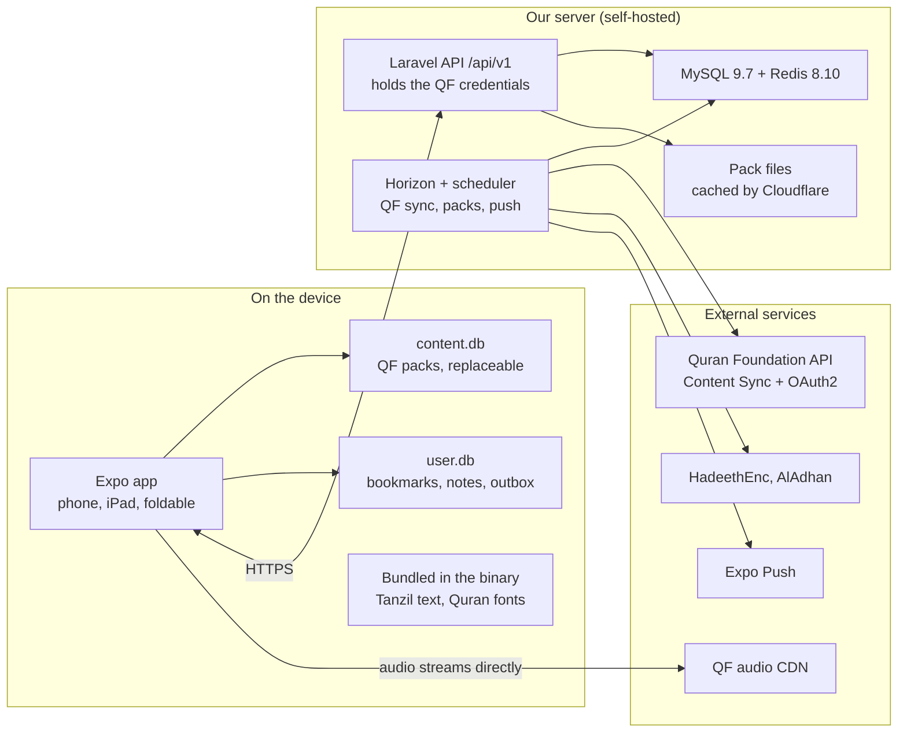

# Quran App — Technical Specification

Oct 26, 2026 · Eyad Alasfahani

## 1. Overview

This is the build spec for one developer: every table, endpoint and folder needed to ship v1, derived from the Quran App content plan, the 30 designed screens and the product decisions already made. Where this spec changes something in the content plan, it says so and why.

**Hard constraints (unchanged from the content plan)**

- Quran text is rendered exactly as received. A checksum of all 6,236 ayahs blocks every release.
- Offline-first: reading, downloaded audio, bookmarks and notes work with no network.
- QF content reaches the device only through our backend, which syncs via QF Content Sync and is re-synced at least every 7 days. No QF database ships in the binary; Tanzil text is the only bundled Quran text.
- Cold start to last-read ayah under 1.5 s; audio start under 1 s on 4G; 60 fps scrolling.
- Responsive on every form factor: phones, iPad (including Split View, Slide Over and Stage Manager) and Android foldables and tablets, in portrait and landscape. Layout follows the window size, never the device model (section 4).
- Free, no donations, no tracking. Arabic first, English second.

**Decided stack:** Expo SDK 58 (React Native 0.88, TypeScript 6) and Laravel 13 on PHP 8.5, MySQL 9.7, Redis 8.10, self-hosted with Docker Compose. Versions are pinned in the content plan and not repeated here.

**Changes from the content plan**

| Area | Content plan | This spec | Why |
| --- | --- | --- | --- |
| Sync conflict rule | Last-write-wins by server receive time | Last-write-wins by client `updated_at`, clamped to server time | An edit made offline yesterday and pushed today would otherwise overwrite today's edit from another device |
| Sync cursor | `since=<timestamp>` | Per-user monotonic `server_version` | Timestamps collide and drift; a counter never skips a row |
| Device storage | One SQLite database | `content.db` (replaceable) + `user.db` (personal data) | A full content re-download can never touch bookmarks or notes |
| Content packs | Shape not defined | Gzipped SQLite files built by the backend, plus a row-level change feed | Importing a prebuilt file takes seconds; JSON inserts of \~83k word rows are slow on low-end Android |
| `device_tokens`, `user_resources` | Separate tables | Folded into `devices` and `user_settings` | Fewer tables for one developer, same data |
| Hifz progress | Listed under user data | Not in v1 | No screen designs it; Focus mode's memorization test is local only |
| Form factors | Phone only (390 pt designs) | Phone, tablet and foldable layouts from one codebase | New requirement; tablet and unfolded layouts still need designs (section 16) |
| Repositories | Not defined | One monorepo: Laravel API, Expo app and the shared API contract | One PR changes an endpoint and its client together; CI checks both |
| Timeline | 18 weeks with a team | Phased solo plan with cut lines (section 15) | One developer cannot carry the full v1 scope in 18 weeks |

**Repository:** one monorepo, `quran`, with npm workspaces for the JavaScript side and Composer inside the API folder. The API publishes an OpenAPI document into `packages/api-contract`, and the app imports TypeScript types generated from it, so a breaking change to section 9 fails the app's type check in the same pull request.

```
quran/
├── apps/
│   ├── api/                 Laravel 13 (composer.json, Dockerfile, Pest)
│   └── mobile/              Expo SDK 58 app (app.config.ts, eas.json)
├── packages/
│   ├── api-contract/        openapi.json (generated by the API) + generated TS types
│   ├── design-tokens/       colors, spacing, radii, type scale pulled from the Figma design file (from the HTML design system until then, ADR 0005)
│   └── quran-text-check/    6,236-ayah checksum tool, used by API CI and app CI
├── infra/                   docker-compose.yml, Caddyfile, deploy scripts
├── .github/workflows/       api.yml, mobile.yml, contract.yml (path-filtered)
├── docs/                    ADRs, runbooks
├── package.json             npm workspaces: apps/mobile, packages/*
├── package-lock.json
└── renovate.json            one config for npm and Composer
```

- **Workspaces:** npm workspaces, matching the content plan's `npm ci` and committed lockfile. Expo SDK 58 detects the monorepo and configures Metro automatically; no custom `metro.config.js` watch folders are needed unless a package is outside `packages/`.
- **No Turborepo or Nx:** with one app and one API, path-filtered CI jobs are enough. Add a task runner only if a second app (web, admin) joins.
- **CI path filters:** `apps/api/**` runs Pint, Larastan, Pest; `apps/mobile/**` and `packages/**` run ESLint, `tsc`, Jest and `expo-doctor`; any change to `packages/api-contract/**` runs both.
- **Contract flow:** a CI step regenerates `openapi.json` from the API (`dedoc/scramble`, which reads routes, FormRequests and API Resources; ADR 0006) and fails if the committed file differs. `openapi-typescript` then regenerates the TS types.
- **EAS:** builds run with `apps/mobile` as the project root; EAS uploads the whole repo, so `.easignore` excludes `apps/api` and `infra`.
- **Docker:** the API image builds with `apps/api` as its context only.

**Standards note:** section 3 has been checked against the `laravel-standards` skill; ADR 0002 records what was adopted and where this spec wins. No Expo standards skill exists yet, so section 4 follows Expo Router's file-based routing; re-check it once one is added.

## 2. System architecture

The app reads everything from its own SQLite databases and talks to exactly two places: our Laravel API over HTTPS and QF's audio CDN. QF credentials live only on the server.



The scheduler pulls from QF, HadeethEnc and AlAdhan and sends pushes through Expo; the API serves packs, the change feed, auth and user sync from the MySQL mirror.

**Request paths**

| Path | Route | Network needed |
| --- | --- | --- |
| Open the reader | MMKV last-read → `content.db` | No |
| Bookmark, highlight, note | `user.db` + outbox → later `POST /sync/push` | No (syncs later) |
| Play a surah | `content.db` timings + audio file (download or CDN stream) | Only to stream |
| Get a new translation or tafsir | `GET /content/manifest` → pack download → `content.db` | Yes, once |
| Content update | Daily QF sync → version bump → pack or change feed → device | Yes |
| Sign in | Provider SDK on device → `/auth/*` → token in secure store | Yes |

## 3. Backend code structure (`apps/api`)

The API is split into domain modules, each layered Controller → FormRequest → Data object → Service → Repository → Model, with an API Resource shaping each response (ADR 0006). Controllers never touch Eloquent, and services never touch HTTP.

```
apps/api/app/
├── Domains/
│   ├── Content/        verses, words, layouts, translations, tafsir, packs, change feed
│   ├── Audio/          reciters, recitations, chapter audio, timings
│   ├── Hadith/         categories, hadiths, translations, daily rotation
│   ├── Identity/       users, email codes, Google, Apple, tokens, deletion, export
│   ├── Sync/           user-data push/pull, conflict resolution, tombstones
│   ├── Devices/        device registry, push tokens, notification preferences
│   └── Notifications/  Expo push channel, daily hadith, announcements
├── Integrations/       one adapter per external provider
│   ├── QuranFoundation/  OAuthTokenProvider, ContentSyncClient, ContentApiClient, Mappers/
│   ├── HadeethEnc/       HadeethEncClient, Mappers/
│   ├── AlAdhan/          AlAdhanClient
│   └── Expo/             ExpoPushClient
├── Support/            ArabicNormalizer, HtmlSanitizer, VerseKey value object, ProblemDetails
└── Filament/           admin panel resources
```

**Inside each domain** (example: `Domains/Sync`)

```
Sync/
├── Http/Controllers/SyncController.php      thin: validate, call service, return a Resource
├── Http/Requests/PushChangesRequest.php
├── Http/Resources/PullResponseResource.php  explicit response fields
├── Data/PushChangeData.php, PullResultData.php   spatie/laravel-data DTOs
├── Services/SyncService.php                 transactions, LWW rule, version bump
├── Repositories/Contracts/UserItemRepository.php
├── Repositories/Eloquent/EloquentUserItemRepository.php
├── Models/Bookmark.php, Highlight.php, Note.php, ...
├── Jobs/PruneTombstonesJob.php
├── Enums/SyncEntity.php, SyncOp.php
└── SyncServiceProvider.php                  binds contracts, registers routes
```

**Conventions**

- **Binding:** each domain's service provider binds repository contracts to Eloquent implementations. Tests can swap them.
- **Data objects between layers, Resources at the edge (ADR 0006):** FormRequests validate and become Data objects; services return Data objects; controllers wrap them in API Resources with explicit fields and no wrapper key. Scramble reads FormRequests and Resources to produce the OpenAPI file; free Scramble can't read Data objects.
- **Transactions live in services**, never in repositories or controllers.
- **Provider adapters** implement `ContentSource` (`fetchChanges`, `fetchSnapshot`, `currentVersion`, `normalize`). Adding or removing a provider never touches a domain service.
- **HTTP clients** use Laravel's client with `retry(3, backoff)`, a User-Agent with the app name and contact email, and 429 handling that respects `Retry-After`.
- **Config:** `config/quran.php` holds QF environment URLs, sync groups, pack settings and limits; secrets come only from env.
- **Quality gates:** Pint (Laravel preset), Larastan level 8, Pest with `--parallel`; architecture tests (`arch()`) enforce that controllers don't use models and that `Integrations` never import `Domains`. `composer qa` runs all three.
- **Team standards (ADR 0002):** the `laravel-standards` skill applies where it doesn't conflict with this spec: `declare(strict_types=1)` and full typing in every file, one shared FormRequest per entity, thin controllers, domain exceptions (rendered as problem details), enums and value objects, eager loading with no N+1, Pest functional tests and Mockery unit tests that mock I/O only. Where they conflict, this spec wins: the envelope of section 8 (API Resources without a wrapper, ADR 0006), cursor pagination only, OpenAPI instead of hand-kept Postman collections, MySQL (not SQLite) for tests. Repositories combine both: a shared Eloquent base class in `Support/Repositories`, with each domain's contract bound to its Eloquent implementation.
- **Phase 0 example:** `Domains/Sync` carries `GET /health` through every layer (provider, contract, Eloquent repository, service, Data object, controller, API Resource) until the sync endpoints arrive in Phase 4.

**Jobs and schedule**

| Job | Queue | Schedule / trigger | Does |
| --- | --- | --- | --- |
| `SyncQuranFoundationJob` | `sync` | Daily 02:00 UTC, per resource group | Pulls Content Sync mutations, applies them in sequence order |
| `ApplyResourceSnapshotJob` | `sync` | On `RESOURCE_CREATE` / `RESOURCE_INVALIDATE` | Downloads the snapshot and replaces that resource's rows |
| `BuildContentPackJob` | `packs` | After a resource's version bumps | Builds the gzipped SQLite pack, stores size and SHA-256 |
| `VerifyTextIntegrityJob` | `sync` | After every `quran_core` change | Recomputes ayah checksums; blocks pack publish on mismatch |
| `SyncHadithJob` | `sync` | Daily 02:30 UTC | Pulls HadeethEnc categories and hadiths for `ar`, `en` |
| `SyncHijriJob` | `default` | Daily 00:05 UTC | Caches today's Hijri date from AlAdhan |
| `SendDailyHadithJob` | `push` | Every 15 minutes | Sends to devices whose local send time has arrived |
| `ReadExpoReceiptsJob` | `push` | Every 30 minutes | Reads push receipts, disables dead tokens |
| `PruneTombstonesJob` | `default` | Daily | Hard-deletes user rows tombstoned over 90 days ago |
| `PruneLoginCodesJob` | `default` | Hourly | Deletes expired or used codes |
| `AlertStaleSyncJob` | `default` | Hourly | Alerts when any group's last success is over 5 days old |
| `RevokeAppleTokenJob` | `default` | On account deletion | Calls Apple `/auth/revoke` |

**Admin (Filament):** content sources and permission status, sync runs and errors, daily hadith calendar with reviewer sign-off, user lookup for support (email and devices only, no notes content).

## 4. App code structure (`apps/mobile`)

Routes live in `app/` and stay thin; everything else lives in feature folders under `src/`. One adaptive shell serves phones, iPads and foldables: the same routes render as tabs and sheets in a narrow window and as a sidebar with side panels in a wide one.

```
apps/mobile/
├── app/                              Expo Router (file-based)
│   ├── _layout.tsx                   providers, DB ready gate, onboarding redirect
│   ├── (onboarding)/language.tsx, script.tsx, reciter.tsx
│   ├── (main)/_layout.tsx            AdaptiveNav: native tabs or sidebar by window class
│   ├── (main)/(home)/index.tsx
│   ├── (main)/(mushaf)/index.tsx     surah and juz index
│   ├── (main)/(listen)/index.tsx, reciter/[id].tsx
│   ├── (main)/(my-quran)/index.tsx   bookmarks, highlights, notes
│   ├── read/[verseKey].tsx           reader: mushaf, reading or focus mode
│   ├── ayah/[verseKey].tsx           ayah actions (sheet or side panel)
│   ├── tafsir/[verseKey].tsx         tafsir (sheet or side panel)
│   ├── reader-settings.tsx           sheet
│   ├── player.tsx                    full-screen player
│   ├── search.tsx, khatma.tsx
│   ├── hadith/index.tsx, category/[id].tsx, [id].tsx
│   ├── settings/index.tsx, translations.tsx, downloads.tsx, account.tsx, sources.tsx
│   ├── auth/sign-in.tsx, auth/verify.tsx
│   └── delete-account.tsx            sheet
└── src/
    ├── core/
    │   ├── api/        fetch client (auth, Accept-Language, X-Device-Id), query keys; types from @quran/api-contract
    │   ├── db/         content/schema.ts, user/schema.ts, migrations/, open.ts (two databases)
    │   ├── sync/       content-sync.ts, user-sync.ts, outbox.ts
    │   ├── layout/     useWindowClass, AdaptiveSplit, ContentColumn, useReadingAnchor
    │   ├── theme/      tokens from @quran/design-tokens; light, sepia, dark
    │   ├── i18n/       ar.json, en.json, RTL switch
    │   ├── storage/    mmkv.ts (prefs, last-read cache), secure.ts (token)
    │   └── telemetry/  Sentry init, performance marks
    ├── features/
    │   ├── reader/  audio/  search/  library/  khatma/  hadith/
    │   ├── auth/  settings/  downloads/  onboarding/  notifications/
    │   └── <feature>/components, hooks, data (repositories), store.ts (only if needed)
    └── shared/ui/      GlassSurface, Sheet, AyahMarker, SurahCartouche, SegmentedControl, ListRow
```

**Where state lives**

| State | Home | Why |
| --- | --- | --- |
| Quran text, layouts, translations, tafsir, timings | `content.db`, read through feature repositories with Drizzle | Offline, large, read-only on device |
| Bookmarks, highlights, notes, khatma, settings, outbox | `user.db`, Drizzle `useLiveQuery` | Reactive lists; survives content re-downloads |
| Account, online tafsir lookups, hadith browsing | TanStack Query | Caching, retries, background refetch |
| Player queue, active ayah and word, repeat range | Zustand `playerStore` | Read by reader, mini-player and player at 10 Hz |
| Last-read verse and page, onboarding flags, theme | MMKV | Synchronous read before the database opens, for the 1.5 s cold start |
| Auth token | `expo-secure-store` | Keychain / Keystore |

**Responsive layout (phones, iPad, foldables)**

Layout is driven by the window's width class from `useWindowDimensions`, never by `Platform.isPad` or the device model. iPad Split View at one third, a folded phone and a phone in portrait all get the compact layout; an unfolded foldable or an iPad in landscape gets the expanded one.

| Window class | Width (dp/pt) | Typical cases | Navigation | Reader | Ayah actions, tafsir, translations | Player |
| --- | --- | --- | --- | --- | --- | --- |
| Compact | under 600 | Phones, folded foldables, iPad Slide Over and 1/3 Split View | Native bottom tabs | Full width | Bottom sheets | Mini-player bar, full-screen player |
| Medium | 600–839 | Unfolded foldables in portrait, iPad mini portrait, iPad 1/2 Split View | Native tabs; iPadOS may show its adaptive tab bar | Centered text column, max width | Large sheets (formSheet on iPad) | Mini-player bar, full-screen player |
| Expanded | 840 and up | iPad landscape and full screen, unfolded foldables in landscape, Android tablets | Sidebar | Centered column beside a side panel | Persistent side panel, 360–420 wide | Mini-player in the sidebar footer; full player as a modal |

- **`useWindowClass()`** returns `compact | medium | expanded` with a small hysteresis (±16) so a resize near a boundary doesn't flicker.
- **`AdaptiveSplit`** renders one pane in compact and medium, and two panes in expanded. The ayah and tafsir routes render into the side pane when it exists and as sheets otherwise, so the routes don't change between form factors.
- **Reading column width:** Reading and Focus modes cap the Quran text column at about 720 pt and center it; long Arabic lines on a 13-inch iPad are hard to track.
- **Mushaf page sizing:** page-exact mode keeps 15 lines per page. Page width is `min(window width − gutters, 640)` and the QCF font size is derived from that width, so a page never re-wraps; wide windows show the page centered with margin, not stretched.
- **Fold, unfold, rotate and resize keep your place.** `useReadingAnchor` records the top visible verse key; on a size change the FlashList re-measures and scrolls back to that verse. Nothing is reloaded.
- **Hinge:** v1 treats an unfolded foldable as a normal medium or expanded window. A hinge-aware two-pane split, which needs a small native module wrapping Jetpack WindowManager, is a post-launch item (section 15).
- **Orientation and multitasking config:** `orientation: "default"`, `ios.supportsTablet: true`, all four iPad orientations declared (required for Split View and Stage Manager), Android `resizeableActivity` left on. No orientation lock anywhere.
- **Input:** pointer hover states on iPad and Android tablets come from Pressable's hover events. Hardware-keyboard shortcuts (space to play or pause, arrows for next ayah) are post-launch.
- **Safe areas:** every screen uses safe-area insets; Liquid Glass bars float above content on iOS 26, and Android uses edge-to-edge with the same insets.

**Cold start path (target under 1.5 s):** read last-read verse and page from MMKV → open `content.db` → query only that page → render. Fonts for that script are bundled; QCF page fonts load for the visible page and its neighbours only.

## 5. Backend database schema (MySQL 9.7)

The schema has four groups: the QF content mirror, hadith, identity and devices, and synced user data. All tables are InnoDB, `utf8mb4` with `utf8mb4_0900_bin` on Quran text columns (byte-exact, so no collation ever folds a diacritic) and `utf8mb4_0900_ai_ci` elsewhere. Timestamps are `datetime(6)` in UTC.

Verses use QF's integer id (1–6,236) as the primary key, with `verse_key` (`2:255`) kept as a unique lookup. Every foreign key from user data points at `verse_id`, so a content re-sync can never orphan a bookmark.

**Provenance and sync state**

| Table | Columns | Keys and indexes |
| --- | --- | --- |
| `content_sources` | `id` bigint, `code` varchar(32), `name` varchar(120), `licence_url` varchar(500), `attribution_ar` text, `attribution_en` text, `permission_status` enum(`granted`,`pending`,`not_required`,`denied`), `notes` text, timestamps | PK `id`; unique `code` |
| `resources` | `id` bigint, `source_id` FK, `group` enum(`quran_core`,`mushafs`,`translations`,`tafsirs`,`word_by_word_translations`,`word_by_word_transliterations`,`recitations`,`chapter_recitations`,`hadith`) (QF's names, ADR 0008), `source_key` varchar(64), `name` varchar(200), `author_name` varchar(200) null, `language_code` varchar(8), `direction` enum(`rtl`,`ltr`), `version` int unsigned, `checksum` char(64) null, `is_active` bool, `synced_at` datetime(6) | PK `id`; unique (`source_id`,`group`,`source_key`); index (`group`,`language_code`) |
| `sync_states` | `id`, `environment` enum(`prelive`,`production`), `resource_group` varchar(32), `sync_token` text, `last_sequence` bigint unsigned, `last_success_at` datetime(6) null, `last_error` text null | unique (`environment`,`resource_group`) |
| `sync_runs` | `id`, `resource_group`, `started_at`, `finished_at` null, `status` enum(`running`,`ok`,`failed`), `mutations_applied` int, `error` text null | index (`resource_group`,`started_at`) |
| `content_packs` | `id`, `resource_id` FK, `version` int unsigned, `path` varchar(500), `size_bytes` bigint, `sha256` char(64), `row_count` int, `schema_version` smallint, `built_at` | unique (`resource_id`,`version`) |
| `content_changes` | `id` bigint auto-increment (the device cursor), `resource_id` FK, `version` int unsigned, `entity` varchar(32), `entity_key` varchar(64), `op` enum(`upsert`,`delete`), `payload` json null, `created_at` | PK `id`; index (`resource_id`,`id`) |

**Quran content mirror**

| Table | Columns | Keys and indexes |
| --- | --- | --- |
| `chapters` | `id` tinyint (1–114), `name_arabic`, `name_simple`, `name_en`, `revelation_place` enum(`makkah`,`madinah`), `revelation_order` tinyint, `verses_count` smallint, `bismillah_pre` bool, `page_start` smallint, `page_end` smallint | PK `id` |
| `verses` | `id` smallint (1–6,236), `verse_key` varchar(7), `chapter_id` FK, `verse_number` smallint, `juz` tinyint, `hizb` tinyint, `rub_el_hizb` smallint, `manzil` tinyint, `ruku` smallint, `page` smallint, `sajdah` enum(`none`,`recommended`,`obligatory`), `text_uthmani` text, `text_uthmani_tajweed` text, `text_indopak` text, `text_imlaei` text, `text_search` text (normalized, generated on ingest) | PK `id`; unique `verse_key`; index (`chapter_id`,`verse_number`); index `page`; index `juz` |
| `words` | `id` int (QF word id), `verse_id` FK, `position` smallint, `char_type` enum(`word`,`end`,`pause`,`sajdah`,`rub`), `text_uthmani`, `text_indopak`, `text_imlaei`, `qcf_code_v2` varchar(16) | PK `id`; unique (`verse_id`,`position`) |
| `mushafs` | `id` smallint, `source_key`, `name`, `pages_count` smallint, `lines_per_page` tinyint, `font_kind` enum(`qcf_v2`,`kfgqpc_hafs`,`indopak`,`tajweed`) | PK `id` |
| `word_layouts` | `mushaf_id` FK, `word_id` FK, `page` smallint, `line` tinyint | PK (`mushaf_id`,`word_id`); index (`mushaf_id`,`page`,`line`) |
| `translation_entries` | `resource_id` FK, `verse_id` FK, `text` text, `footnotes` json null | PK (`resource_id`,`verse_id`) |
| `word_translations` | `resource_id` FK, `word_id` FK, `text` varchar(255), `transliteration` varchar(255) null | PK (`resource_id`,`word_id`) |
| `tafsir_entries` | `id`, `resource_id` FK, `first_verse_id` FK, `last_verse_id` FK, `html` mediumtext (sanitized), `source_hash` char(64) | index (`resource_id`,`first_verse_id`,`last_verse_id`) |
| `tafsir_lookups` | `resource_id`, `verse_id`, `html` mediumtext, `fetched_at` | PK (`resource_id`,`verse_id`); rows older than 7 days are purged |

**Audio**

| Table | Columns | Keys and indexes |
| --- | --- | --- |
| `reciters` | `id`, `source_key`, `name_ar`, `name_en`, `style` enum(`murattal`,`mujawwad`,`muallim`), `is_active` bool, `sort_order` smallint | unique `source_key` |
| `recitations` | `id`, `reciter_id` FK, `resource_id` FK, `riwayah` varchar(32) default `hafs`, `has_word_segments` bool | unique `resource_id` |
| `chapter_audio_files` | `id`, `recitation_id` FK, `chapter_id` FK, `audio_url` varchar(500), `size_bytes` bigint null, `duration_ms` int unsigned, `format` varchar(8) | unique (`recitation_id`,`chapter_id`) |
| `recitation_timings` | `audio_file_id` FK, `verse_id` FK, `start_ms` int unsigned, `end_ms` int unsigned, `segments` json null (`[[word_position, start_ms, end_ms], …]`) | PK (`audio_file_id`,`verse_id`); check `start_ms < end_ms` |

**Hadith**

| Table | Columns | Keys and indexes |
| --- | --- | --- |
| `hadith_categories` | `id`, `source_id` FK, `source_key`, `parent_id` null FK self, `title_ar`, `title_en` null, `hadiths_count` int | unique (`source_id`,`source_key`) |
| `hadiths` | `id`, `source_id` FK, `source_key`, `text_ar` text, `grade_ar` varchar(120), `attribution_ar` text (narrator and collection), `source_url` varchar(500), `version` int | unique (`source_id`,`source_key`) |
| `hadith_category_hadith` | `category_id` FK, `hadith_id` FK | PK (`category_id`,`hadith_id`) |
| `hadith_translations` | `hadith_id` FK, `language_code`, `text` text, `explanation` text null, `benefits` json null, `grade` varchar(120) null, `attribution` text null | PK (`hadith_id`,`language_code`) |
| `daily_hadiths` | `date` date, `hadith_id` FK, `approved_by` FK admin null, `approved_at` null | PK `date`; only approved rows are served |

**Identity and devices**

| Table | Columns | Keys and indexes |
| --- | --- | --- |
| `users` | `id` bigint, `name` varchar(120) null, `email` varchar(255), `email_verified_at` null, `locale` enum(`ar`,`en`), `timezone` varchar(64), `sync_version` bigint unsigned default 0, timestamps | unique `email` |
| `social_accounts` | `id`, `user_id` FK cascade, `provider` enum(`google`,`apple`), `provider_user_id` varchar(255), `email` varchar(255) null, `apple_refresh_token` text encrypted null, timestamps | unique (`provider`,`provider_user_id`); index `user_id` |
| `login_codes` | `id`, `email`, `code_hash` char(64), `attempts` tinyint, `ip` varbinary(16), `expires_at`, `consumed_at` null, `created_at` | index (`email`,`created_at`) |
| `personal_access_tokens` | Sanctum default, plus `device_id` uuid | index `device_id` |
| `devices` | `id` uuid (client install id), `user_id` FK null set-null, `platform` enum(`ios`,`android`), `form_factor` enum(`phone`,`tablet`,`foldable`) null, `app_version` varchar(20), `locale`, `timezone`, `push_token` varchar(255) null, `push_daily_hadith` bool, `push_announcements` bool, `daily_hadith_time` time default 08:00, `push_disabled_at` null, `last_seen_at` | PK `id`; index `user_id`; index (`push_daily_hadith`,`timezone`) |

**Synced user data**

Every table below shares the same sync columns: `id` uuid (client-generated, PK), `user_id` FK cascade, `client_updated_at` datetime(6), `server_version` bigint unsigned, `deleted_at` datetime(6) null, `created_at`. Each has an index on (`user_id`,`server_version`) for pulls.

| Table | Own columns | Extra keys |
| --- | --- | --- |
| `bookmarks` | `verse_id` FK, `kind` enum(`verse`,`page`), `page` smallint null | unique (`user_id`,`kind`,`verse_id`) among live rows, enforced in the service |
| `highlights` | `verse_id` FK, `color` enum(`gold`,`green`,`blue`,`rose`) | one live highlight per (`user_id`,`verse_id`) |
| `notes` | `verse_id` FK, `body` text (max 10,000 chars) | index (`user_id`,`verse_id`) |
| `khatma_plans` | `duration_days` smallint, `start_verse_id` FK, `start_date` date, `status` enum(`active`,`completed`,`abandoned`), `completed_at` null | one active plan per user |
| `khatma_logs` | `plan_id` FK, `date` date, `pages_read` smallint, `last_verse_id` FK | unique (`plan_id`,`date`) |
| `reading_positions` | `verse_id` FK, `page` smallint, `mushaf_id` FK | one row per user (`id` derived from `user_id`) |
| `user_settings` | `settings` json (script, mode, theme, font scale, translations, default tafsir, default reciter, Wi-Fi-only, dark after Maghrib, reminder time) | one row per user |

Account deletion hard-deletes the user; cascades remove every row above, and `devices.user_id` is set to null.

## 6. Device database schema (SQLite)

The app opens two SQLite databases with `expo-sqlite` and Drizzle: `content.db`, which can be deleted and rebuilt from packs at any time, and `user.db`, which holds everything personal and is never touched by content updates. Both run in WAL mode.

**`content.db`** mirrors the backend shape, trimmed to what the device renders.

| Table | Columns | Keys and indexes |
| --- | --- | --- |
| `meta` | `key` text, `value` text (schema version, bundled Tanzil marker) | PK `key` |
| `installed_resources` | `resource_id` int, `group` text, `version` int, `sha256` text, `last_checked_at` int, `change_cursor` int | PK `resource_id` |
| `chapters` | as backend | PK `id` |
| `verses` | `id`, `verse_key`, `chapter_id`, `verse_number`, `juz`, `hizb`, `rub_el_hizb`, `page`, `sajdah`, `text_uthmani`, `text_uthmani_tajweed` null, `text_indopak` null, `text_imlaei`, `text_search` | PK `id`; unique `verse_key`; index `page`; index (`chapter_id`,`verse_number`) |
| `words` | `id`, `verse_id`, `position`, `char_type`, `text_uthmani`, `text_indopak` null, `qcf_code_v2` null | PK `id`; index (`verse_id`,`position`) |
| `word_layouts` | `mushaf_id`, `word_id`, `page`, `line` | PK (`mushaf_id`,`word_id`); index (`mushaf_id`,`page`,`line`) |
| `translation_entries` | `resource_id`, `verse_id`, `text`, `footnotes` | PK (`resource_id`,`verse_id`) |
| `word_translations` | `resource_id`, `word_id`, `text`, `transliteration` | PK (`resource_id`,`word_id`) |
| `tafsir_entries` | `id`, `resource_id`, `first_verse_id`, `last_verse_id`, `html` | index (`resource_id`,`first_verse_id`) |
| `reciters`, `recitations`, `chapter_audio_files` | as backend | — |
| `recitation_timings` | `audio_file_id`, `verse_id`, `start_ms`, `end_ms`, `segments` (JSON text) | PK (`audio_file_id`,`verse_id`) |
| `hadith_categories`, `hadiths`, `hadith_translations`, `hadith_category_hadith` | as backend, `ar` + interface language only | — |
| `search_quran` | FTS5 virtual table: `verse_id` UNINDEXED, `text_search` | `tokenize='unicode61 remove_diacritics 2'` |
| `search_study` | FTS5 virtual table: `resource_id` UNINDEXED, `verse_id` UNINDEXED, `body` | filled from downloaded translations and tafsir only |

**`user.db`** stores synced data plus local-only state.

| Table | Columns | Notes |
| --- | --- | --- |
| `bookmarks`, `highlights`, `notes`, `khatma_plans`, `khatma_logs`, `reading_position`, `settings` | same own columns as the backend, plus `id` uuid, `client_updated_at` int (ms), `deleted_at` int null, `dirty` int (0/1) | `dirty = 1` until the server acknowledges the change |
| `outbox` | `seq` integer autoincrement, `entity` text, `entity_id` text, `op` text (`upsert`,`delete`), `payload` text, `client_updated_at` int, `attempts` int | PK `seq`; one pending row per (`entity`,`entity_id`): a newer edit replaces the older one |
| `sync_meta` | `key`, `value` (`pull_cursor`, `last_push_at`, `last_pull_at`, `owner_user_id`) | PK `key` |
| `downloads` | `audio_file_id`, `local_path`, `size_bytes`, `status` (`queued`,`downloading`,`done`,`failed`), `progress`, `downloaded_at` | PK `audio_file_id` |
| `recent_listens` | `audio_file_id`, `last_position_ms`, `played_at` | for Home's "last listened" |
| `search_history` | `query`, `searched_at` | local only, capped at 20 |

**Packs and the first launch**

1. The binary bundles a small `content.db` seed: chapters, verses with Tanzil Uthmani text, and nothing from QF. The reader works on first launch with no network.
2. Once online, the app fetches the manifest and downloads the `quran_core` pack (verses, words, layouts for the chosen mushaf). Each pack is a gzipped SQLite file; the app checks its SHA-256, `ATTACH`es it, copies rows into `content.db` in one transaction and detaches it.
3. After `quran_core` lands, the Tanzil rows are replaced and `meta.bundled_text` is cleared, as the content plan requires.
4. Further packs (a translation, a tafsir, a recitation's timings, hadith) follow the same path when the reader picks them.
5. Migrations: Drizzle migrations run on open for both databases. A `content.db` schema change can simply delete the file and re-import packs; `user.db` migrations are always additive.

## 7. Content pipeline

Content moves in three hops: QF Content Sync → backend mirror → pack or change feed → device. Every hop is versioned per resource, so the device only ever asks "what changed since version N of resource R?".

**Hop 1: QF → backend mirror (daily, `SyncQuranFoundationJob`)**

1. Get a client-credentials token (`scope=content`), cached in Redis until 60 s before expiry.
2. First run per group: `GET /resources/sync?bootstrap=true&resources=<group>`, fetch every `snapshot_url`, store the final `next_sync_token` in `sync_states`.
3. Later runs: call with the stored token; apply mutations in ascending `sequence`, each mutation in its own transaction that also advances `last_sequence`, so a crash resumes exactly where it stopped.
4. `RESOURCE_CREATE` / `RESOURCE_INVALIDATE` → dispatch `ApplyResourceSnapshotJob` (replace that resource's rows in one transaction). `ROW_*` → upsert or delete one row and write a `content_changes` row. `RESOURCE_DELETE` → mark the resource inactive and write a delete change.
5. On any change, bump `resources.version` once per run (not per row), then dispatch `BuildContentPackJob`.
6. `quran_core` changes also dispatch `VerifyTextIntegrityJob`: the job recomputes SHA-256 per script over the 6,236 ayahs in id order and compares it with the stored source checksum. A mismatch marks the version unpublishable and alerts; the previous pack stays live.
7. Normalization on ingest: tafsir HTML is sanitized to the whitelist from the content plan; `text_search` is derived (diacritics and tatweel removed, alef forms → ا, ى → ي, ة → ه). Source text columns are stored byte-for-byte as received.

**Hop 2: backend → packs and change feed**

- **Pack:** `BuildContentPackJob` writes a SQLite file with only that resource's tables, `VACUUM`s it, gzips it, stores it under `storage/packs/{resource}/{version}.sqlite.gz` and records size and SHA-256. Cloudflare caches pack URLs, which are immutable because the version is in the path.
- **Change feed:** `content_changes` keeps row-level changes for 30 days. A device within that window applies only the delta; an older device gets `410 Gone` and downloads the latest pack.
- **Pack contents by group:** `quran_core` (chapters, verses, words, one mushaf's layouts), `mushaf:{id}` (extra layouts), `translation:{id}`, `wbw:{lang}`, `tafsir:{id}`, `recitation:{id}` (reciter, files, timings), `hadith:{lang}`.

**Hop 3: device update (`core/sync/content-sync.ts`)**

1. Runs at app start when online, when the app returns to the foreground after 6 hours, and from a background task once a day where the OS allows.
2. Calls `GET /content/manifest` with `If-None-Match`; a `304` ends the run.
3. For each installed resource: same version → mark checked; newer version within the feed window → `GET /content/changes`; `410` or a schema bump → download the pack.
4. All writes for one resource happen in one transaction; the reader never sees a half-applied update.
5. After `quran_core` updates, the app recomputes the ayah checksum on device and compares it with the manifest's `sha256_text`; a mismatch discards the update and reports to Sentry.
6. **7-day rule:** `installed_resources.last_checked_at` older than 7 days shows a quiet banner asking the reader to connect. What happens to QF content after a longer offline period is an open question for QF (section 16); the code path to purge QF rows and fall back to Tanzil exists behind a remote flag.

## 8. API conventions

One JSON API under `/api/v1`, used only by our app. These rules apply to every endpoint in section 9.

- **Versioning:** the major version is in the path. Additive changes (new fields, new endpoints) never bump it; the app ignores unknown fields. `GET /bootstrap` returns `min_app_version`, and older builds show an update prompt.
- **Required headers:** `X-Device-Id` (the install UUID, generated on first launch and kept in secure storage), `X-App-Version`, `X-Platform` (`ios` / `android`), `Accept-Language` (`ar` or `en`). `Authorization: Bearer <token>` only on authenticated routes.
- **Auth:** Sanctum personal access tokens, one per device, no expiry, revocable from the devices list. Guests call public endpoints with no token.
- **Envelope:** success responses return the resource directly (`{...}`) or a list as `{ "data": [...], "next_cursor": "..." | null }`. No wrapping `success` flags.
- **Errors:** RFC 9457 problem details (`application/problem+json`): `type`, `title` (localized), `status`, `detail`, plus `code` (stable machine string such as `login_code_invalid`) and `errors` (field → messages) for 422.
- **Pagination:** opaque cursors (`?cursor=`, `limit` default 50, max 500). No offset pagination anywhere.
- **Caching:** content endpoints send `ETag` and `Cache-Control: public`; pack downloads are immutable (`max-age=31536000, immutable`). User endpoints send `Cache-Control: no-store`.
- **Idempotency:** sync push items are keyed by their UUID, so a retried push is harmless. `POST /auth/email/request` is rate-limited instead.
- **Rate limits (per IP unless noted):** content 300/min; auth code request 5/hour per email and 20/hour per IP; code verify 10 attempts per code; sync 60/min per user; device registration 30/hour per device. Limits return `429` with `Retry-After`.
- **Time:** all timestamps are ISO 8601 UTC with milliseconds; dates are `YYYY-MM-DD`.
- **Identifiers:** verses are addressed by `verse_key` in URLs (`2:255`) and by `verse_id` in payloads. User items use client UUIDs.
- **Localization:** `Accept-Language` picks error messages, email language and hadith translation; it never changes Quran text, translations or tafsir.
- **Transport:** HTTPS only (TLS 1.2+), HSTS, gzip/brotli via Caddy, request bodies capped at 1 MB.

## 9. API endpoints

Twenty-seven endpoints cover v1. The OpenAPI file generated from the code is the source of truth; this table is the plan it must match.

| Method | Path | Auth | Purpose | Main responses |
| --- | --- | --- | --- | --- |
| GET | `/health` | none | API, database and Redis reachability for the app and monitoring; `Cache-Control: no-store` (ADR 0001) | 200, 503 |
| GET | `/bootstrap` | none | Min app version, feature flags, today's Hijri date, daily hadith id, source credits | 200 |
| GET | `/content/manifest` | none | Every available resource with latest version, pack URL, size, SHA-256 | 200, 304 |
| GET | `/content/packs/{resource_id}/{version}` | none | Gzipped SQLite pack (redirect to the cached file) | 302, 404 |
| GET | `/content/changes` | none | Row changes for one resource since a version (`resource_id`, `since_version`, `cursor`) | 200, 410 |
| GET | `/content/tafsirs/{resource_id}/verses/{verse_key}` | none | One tafsir entry for an ayah before the pack is downloaded | 200, 404 |
| GET | `/content/resources` | none | Catalogue of translations, tafsirs, word-by-word languages with names and authors (`?group=&language=`) | 200 |
| GET | `/reciters` | none | Reciters with style, recitations, word-segment support | 200 |
| GET | `/reciters/{id}/chapters/{chapter}` | none | Audio URL, size, duration and timings for one surah (streaming before the recitation pack exists) | 200, 404 |
| GET | `/hadith/categories` | none | Category tree | 200 |
| GET | `/hadith/categories/{id}/hadiths` | none | Hadiths in a category, paginated | 200 |
| GET | `/hadith/{id}` | none | One hadith with grade, attribution, explanation, benefits, source URL | 200, 404 |
| GET | `/hadith/daily` | none | Approved hadith for `?date=` (default today in `X-Timezone`) | 200, 404 |
| POST | `/auth/email/request` | none | Send a 6-digit code | 202, 422, 429 |
| POST | `/auth/email/verify` | none | Exchange code for a token | 200, 422, 429 |
| POST | `/auth/google` | none | Exchange Google ID token for a token | 200, 401, 422 |
| POST | `/auth/apple` | none | Exchange Apple identity token and auth code for a token | 200, 401, 422 |
| POST | `/auth/logout` | token | Revoke this device's token | 204 |
| GET | `/me` | token | Profile and sync status | 200 |
| PATCH | `/me` | token | Update name, locale, timezone | 200, 422 |
| GET | `/me/export` | token | Full JSON export of the user's data | 200 |
| DELETE | `/me` | token | Delete the account and all server data | 204, 422 |
| GET | `/me/devices` | token | Signed-in devices | 200 |
| DELETE | `/me/devices/{device_id}` | token | Sign another device out | 204, 404 |
| POST | `/sync/push` | token | Upload outbox changes | 200, 422 |
| GET | `/sync/pull` | token | Changes since a cursor | 200 |
| PUT | `/devices/{device_id}` | optional | Register or update a device, push token and notification choices (works for guests) | 200, 422 |

**Auth exchange (email, Google and Apple share the response)**

```json
POST /api/v1/auth/email/verify
{ "email": "name@example.com", "code": "482913",
  "device": { "id": "8b0c…", "name": "iPad Pro", "platform": "ios", "form_factor": "tablet" } }

200
{ "token": "12|Xk…", "user": { "id": 41, "name": null, "email": "name@example.com",
  "locale": "ar", "timezone": "Africa/Cairo", "providers": ["email"] },
  "is_new_user": true }
```

`POST /auth/apple` body: `identity_token`, `authorization_code`, `full_name` (only sent by Apple on first sign-in), `device`. `POST /auth/google` body: `id_token`, `device`.

**Sync push**

```json
POST /api/v1/sync/push
{ "changes": [
  { "entity": "bookmark", "id": "0f6e…", "op": "upsert",
    "client_updated_at": "2026-10-27T18:02:11.120Z",
    "data": { "verse_id": 262, "kind": "verse" } },
  { "entity": "note", "id": "a91c…", "op": "delete",
    "client_updated_at": "2026-10-27T18:03:40.004Z" } ] }

200
{ "results": [
    { "id": "0f6e…", "status": "applied", "server_version": 118 },
    { "id": "a91c…", "status": "stale", "server_version": 117 } ],
  "cursor": "MTE4" }
```

`status` is `applied`, `stale` (the server has a newer `client_updated_at`; the device pulls and takes the server copy) or `rejected` (with a `code`, for example `verse_not_found`). At most 500 changes per request.

**Sync pull**

```json
GET /api/v1/sync/pull?cursor=MTAy&limit=500

200
{ "changes": [
    { "entity": "highlight", "id": "c2d4…", "op": "upsert", "server_version": 103,
      "client_updated_at": "2026-10-26T21:10:00.000Z",
      "data": { "verse_id": 5, "color": "gold" } },
    { "entity": "bookmark", "id": "77aa…", "op": "delete", "server_version": 104 } ],
  "cursor": "MTA0", "has_more": false }
```

**Content manifest (excerpt)**

```json
{ "generated_at": "2026-10-27T02:14:00Z", "pack_schema_version": 1,
  "resources": [
    { "id": 1, "group": "quran_core", "version": 14, "name": "Quran (Hafs)",
      "pack": { "url": "/api/v1/content/packs/1/14", "size_bytes": 9412211, "sha256": "…" },
      "sha256_text": "…", "changes_since_min_version": 9 },
    { "id": 171, "group": "tafsirs", "version": 3, "name": "التفسير الميسر",
      "language": "ar", "author": "…", "pack": { … } } ] }
```

**Device registration**

```json
PUT /api/v1/devices/8b0c…
{ "platform": "android", "form_factor": "foldable", "app_version": "1.0.0",
  "locale": "ar", "timezone": "Asia/Dubai", "push_token": "ExponentPushToken[…]",
  "notifications": { "daily_hadith": true, "announcements": false, "daily_hadith_time": "08:00" } }
```

## 10. Authentication

All three sign-in methods end in the same place: `IdentityService::signIn(ProviderIdentity, DeviceData)` finds or creates the user, links the provider, and issues one Sanctum token for that device.

**Account matching**

1. Look up `social_accounts` by (`provider`, `provider_user_id`). Found → that user.
2. Otherwise, if the provider returned a verified email, look up `users.email`. Found → link the provider to that user.
3. Otherwise create a user. Apple private-relay emails are stored as given and treated as distinct addresses.
4. Revoke any existing token for the same `device_id`, then issue a new one with name `device:{device_id}`.

**Email code**

- `request`: normalize the email (trim, lowercase), invalidate earlier unused codes, generate 6 digits with `random_int`, store `hash_hmac('sha256', code, APP_KEY)`, queue the localized email. Always return `202`, whether or not the email exists.
- `verify`: compare hashes in constant time, allow 10 attempts per code and 10 minutes of validity, mark the code consumed, then sign in. The verified email sets `email_verified_at`.

**Google**

- The app uses `@react-native-google-signin/google-signin` with the web client ID as `webClientId`, so the ID token's audience is a value the server knows.
- The server verifies with `Google\Client::verifyIdToken`, checks `aud` against the configured iOS, Android and web client IDs, and requires `email_verified`.

**Apple (iOS only)**

- The app requests `FULL_NAME` and `EMAIL` scopes; the name only arrives on first sign-in, so the app sends it in that same request.
- The server fetches Apple's JWKS (cached 24 hours), verifies the identity token's signature, `iss` = `https://appleid.apple.com`, `aud` = bundle ID, expiry, and the nonce the app generated.
- It then exchanges `authorization_code` at Apple's token endpoint with a client secret JWT signed by the Sign in with Apple key (ES256), and stores the refresh token encrypted. That refresh token is what `/auth/revoke` needs at account deletion.
- The sending domain is registered for Apple's private email relay so codes and notices reach relay addresses.

**Tokens on the device**

- The token is stored in `expo-secure-store` with `keychainAccessible: AFTER_FIRST_UNLOCK`, so background sync works after a reboot.
- A `401` from any endpoint clears the token, keeps all local data, and shows signed-out state; it never deletes `user.db`.

**Sign-out and deletion**

- Sign-out: `POST /auth/logout`, clear the token, unregister push for user-scoped notifications, keep local data. `sync_meta.owner_user_id` is kept so a later sign-in to a different account can ask before merging.
- Delete account: confirm in the sheet → `DELETE /me` with `{ "confirm": true }` → in one transaction delete the user (cascades) and null `devices.user_id`, then queue `RevokeAppleTokenJob` if an Apple account was linked. The app clears the token and `sync_meta`, and keeps downloaded Quran content.
- Export: `GET /me/export` returns bookmarks, highlights, notes, khatma and settings as one JSON file, shared through the OS share sheet.

## 11. User data sync

Every personal change is written to `user.db` first and synced later; the network is never on the path of a tap. Each item resolves independently by last-write-wins on `client_updated_at`.

**On the device (`core/sync/user-sync.ts`)**

1. A write updates the row, sets `dirty = 1`, stamps `client_updated_at = Date.now()`, and upserts one `outbox` row for that item (a second edit before sync replaces the first).
2. A sync runs at app start, on foreground, 3 seconds after the last local change (debounced), and after sign-in. Only one run at a time.
3. **Push:** send up to 500 outbox rows. For `applied`, delete the outbox row and clear `dirty`; for `stale`, delete the outbox row and let the pull overwrite; for `rejected`, delete the outbox row, keep the local row and log to Sentry.
4. **Pull:** loop `GET /sync/pull` from `pull_cursor` until `has_more` is false. For each change, skip it if the local row is `dirty` and newer; otherwise apply it. Save the cursor after each page.
5. Failures back off 5 s, 30 s, 2 min, 10 min; the outbox survives app restarts.

**On the server (`SyncService::push`)**

For each change, in one transaction per request:

1. Validate the entity and `data` (verse exists, colour in the enum, note length).
2. Clamp `client_updated_at` to `now() + 5 minutes`, so a device with a wrong clock can't win every conflict forever.
3. Lock the existing row (`SELECT … FOR UPDATE`). If it exists and its `client_updated_at` is newer or equal, return `stale`.
4. Otherwise increment `users.sync_version` and write the row with that `server_version`; a delete sets `deleted_at` (tombstone) instead of removing the row.
5. Uniqueness rules (one live highlight per ayah, one active khatma) are enforced here: the losing row becomes a tombstone with the next `server_version`, so other devices remove it too.

**Special cases**

| Case | Rule |
| --- | --- |
| Last-read position | One row per user; newest `client_updated_at` wins, same as everything else |
| Settings | One JSON document per user, whole-document last-write-wins; the reader's display choices rarely conflict |
| Khatma logs | Keyed by (`plan_id`, `date`); two devices logging the same day merge by taking the larger `pages_read` and the further `last_verse_id` |
| Guest data at first sign-in | All local rows are queued into the outbox and pushed; nothing special on the server, because client UUIDs never collide |
| Signing in to a different account than last time | The app asks: merge this device's data into the new account, or keep it local only |
| Tombstones | Purged after 90 days; a device whose cursor is older than the oldest tombstone gets `full_resync: true` and re-pulls from zero |

**Tests that must exist (Pest + Jest):** two devices edit the same note offline; delete on one device while the other edits; guest merge with duplicate highlights; clock skew of +1 day; cursor older than 90 days; push retried after a network drop.

## 12. Reader, audio and search

**Reader (`features/reader`)**

- **One list, three modes.** Every mode is a vertical FlashList. Mushaf mode's items are pages (604); Reading and Focus modes' items are ayahs (6,236). Switching mode keeps the anchor verse.
- **Item sizing:** Mushaf pages have a known height for a given width (15 lines × line height derived from the page width), so `overrideItemLayout` gives exact offsets and jump-to-ayah lands without measuring. Reading-mode rows are measured and cached per (window width, font scale, translations) key; a fold, unfold or rotation clears the cache and restores the anchor.
- **Mushaf rendering:** each line is one `Text` run of QCF v2 glyph codes in that page's font, justified by the font itself. The page font is loaded with `expo-font` when the page is within two of the viewport and released past ten. KFGQPC Hafs, IndoPak and Tajweed scripts render ayah text in the bundled fonts and flow lines by width instead.
- **Ayah hit-testing:** each word is a nested `Text` with an `onPress` that resolves to its `verse_id`; long-press opens ayah actions (sheet on compact, side panel on expanded).
- **Highlights:** user highlights and the audio-active ayah are background spans on the same nested `Text`, coloured from theme tokens; the active ayah wins.
- **Accessibility:** each ayah exposes its Imla'i text plus "الآية ٥" as its accessibility label, as the content plan requires.

**Audio (`features/audio`)**

- **Playback:** `expo-audio` with background mode and lock-screen metadata (reciter, surah, artwork). The queue is one file per surah; reaching the end starts the next surah.
- **Audio → ayah:** the player reports position about every 100 ms. The timing rows for the current file are loaded into memory (at most 286 rows), and a binary search finds the row with `start_ms ≤ t < end_ms`. The resulting verse id goes to `playerStore`; the reader highlights it and scrolls to it if it is off-screen, unless the reader scrolled by hand in the last 5 seconds.
- **Word highlight:** when `segments` exist, the same search inside the active ayah gives the word position, animated with Reanimated. Reciters without segments get ayah-level highlight only; reciters without timings play without highlight or repeat.
- **Ayah → audio:** "Play from here" loads the surah file if needed and seeks to `start_ms`.
- **Repeat:** a range A–B with N repeats seeks back to A's `start_ms` whenever `t ≥ B.end_ms`, then continues. Speed (0.5×–2×) and sleep timer (end of ayah, end of surah, 15/30/60 min) live in `playerStore`.
- **Downloads:** `expo-file-system` downloads to the app's document directory with progress, resume after interruption, Wi-Fi-only by default, and the same timing rows (offsets are relative to the file).
- **Validation on ingest:** timings with `start_ms ≥ end_ms` or overlaps are rejected for that file, and the app falls back to no highlight for it.

**Search (`features/search`)**

- **Quran text:** query and index are normalized with the same rules as `text_search` (no diacritics or tatweel, unified alef and hamza forms, ى → ي, ة → ه) and matched in the `search_quran` FTS5 table. Results show the original Uthmani text with the matched words highlighted by position.
- **Surahs:** a prefix match on Arabic and transliterated names, plus surah numbers.
- **Translation and tafsir:** `search_study` FTS5 over downloaded resources only; the filter chip is hidden when nothing is downloaded.
- **Root search** (shown in the search screen's hint) needs word-root data, which QF exposes as a separate resource; it is post-launch.
- **Budget:** results for a three-letter query in under 150 ms on a mid-range Android, measured in the release build.

**Motion (reviewed against Apple's HIG on motion, accessibility and Liquid Glass)**

- **Native first:** sheets, the full player and the tab bar use native components (Expo Router `formSheet` with detents, a modal, native tabs), which bring system motion, gesture tracking and Reduce Motion handling.
- **Custom motion uses the tokens** from `src/core/theme/motion.ts`, never raw values:
  - `timing(duration)` with ease-out for opacity and color.
  - `spring()` (damping ratio 1, 350 ms, no bounce) for position and size, including the release after a drag.

| Interaction | Component | Motion | Reduce Motion |
| --- | --- | --- | --- |
| Ayah actions, tafsir, reader settings | Native form sheet | System | System |
| Mini-player → full player | Pan gesture + `spring()` | Tracks the finger; springs open or closed on release | Fade, `slow` |
| Tab change | Native tabs | System | System |
| Tab bar minimize on scroll | Native tabs (iOS 26); Android's bar stays fixed | System | System |
| Ayah highlight (audio) | Reanimated opacity | Cross-fade, `fast` (150 ms) | Same (a fade) |
| Word highlight | Reanimated | `instant` (80 ms) or none, so it keeps up with the 150 ms sync budget | None |
| Auto-scroll to the active ayah | FlashList | Animated scroll | Jump |
| Glass show or hide | `GlassView` style | Switch `regular` ↔ `none` (never fade its opacity) | Switch without animating; no animated blur |
| Reading mode or script change | Segmented control + content | Cross-fade, `standard` | Same |

- **Cancelling motion:** any touch on the reader stops auto-scroll at once and shows a pill to return to the current ayah; following resumes only when it is tapped.
- **Haptics** (`expo-haptics`, added to the content plan when Phase 1 first uses it):
  - Selection feedback when the reading mode, script or reciter changes.
  - Success when a khatma day is completed.
  - None on scrolling or page changes, which happen too often.
  - The system haptics setting turns them off.

## 13. Notifications, environments and monitoring

Reminders are local; only the daily hadith and rare announcements come from the server. Three environments keep QF prelive and production keys apart.

**Notifications**

- **Local (`expo-notifications`):** daily reading reminder and khatma reminder are scheduled on the device at the user's time; they are rescheduled when the time zone, plan or setting changes. Permission is requested only when a switch is turned on.
- **Daily hadith push:** `SendDailyHadithJob` runs every 15 minutes, selects devices with `push_daily_hadith = 1` whose local time just passed `daily_hadith_time` and who haven't received today's hadith, and sends in batches of 100 through the Expo Push API. Quiet hours 23:00–07:00 local are enforced server-side.
- **Payload:** title and body in the device's locale, `data: { "route": "/hadith/123" }`; tapping opens that route through Expo Router.
- **Receipts:** `ReadExpoReceiptsJob` sets `push_disabled_at` on `DeviceNotRegistered`.

**Environments**

|  | Local | Staging | Production |
| --- | --- | --- | --- |
| API | `php artisan serve` on local PHP 8.5 with Homebrew MySQL and Redis; no Docker or Caddy for now (ADR 0003, 0004) | Small VPS behind Caddy | Production VPS (4 vCPU, 8 GB, 80 GB) behind Caddy |
| QF keys | Prelive | Prelive | Production |
| EAS channel | `development` | `preview` | `production` |
| App variant | `com.<org>.quran.dev` | `com.<org>.quran.preview` | `com.<org>.quran` |
| Mail | Log driver (Mailpit once Docker returns, ADR 0004) | Transactional provider, sandbox | Transactional provider |
| Push | Expo push to dev builds | Expo push to TestFlight / internal testing | Expo push to store builds |

Three bundle IDs let dev, preview and production builds sit side by side on one test iPad or foldable.

**Configuration and secrets**

- API: `QF_ENV`, `QF_CLIENT_ID`, `QF_CLIENT_SECRET`, `GOOGLE_CLIENT_IDS` (iOS, Android, web), `APPLE_TEAM_ID`, `APPLE_KEY_ID`, `APPLE_PRIVATE_KEY`, `APPLE_BUNDLE_ID`, `EXPO_ACCESS_TOKEN`, `MAIL_*`, `SENTRY_LARAVEL_DSN`. All live in the server's environment and GitHub environment secrets, never in the repo.
- App: `app.config.ts` reads `APP_VARIANT` and `EXPO_PUBLIC_API_URL` per EAS build profile. No secret ever ships in the app.

**Monitoring**

| Signal | Tool | Alert when |
| --- | --- | --- |
| Content sync age | `AlertStaleSyncJob` → email | Any group over 5 days |
| Sync failures, QF 401/429 | Sentry (Laravel) | Any occurrence |
| Queue backlog | Horizon | Wait over 5 min on `sync` or `push` |
| API latency, slow queries | Pulse | p95 over 300 ms for 10 min |
| App crashes, ANRs | Sentry (React Native) | Crash-free sessions under 99.5% |
| Cold start, audio start | Sentry performance spans | p75 over 1.5 s / 1 s |
| Uptime | External checker on `/up` | Two failed checks |

## 14. Testing and CI

The Quran text checksum is the one test that blocks everything; layout checks across form factors block every release that touches the reader.

**Test layers**

| Layer | Tool | Covers | Runs |
| --- | --- | --- | --- |
| API unit and feature | Pest, `Http::fake` with recorded QF fixtures | Every endpoint, sync rules, auth providers, pack builder, sanitizer | Every PR touching `apps/api` |
| API architecture | Pest `arch()` | Layering rules from section 3 | Every PR |
| Static analysis | Larastan level 8, `tsc --noEmit`, ESLint | Types across both apps | Every PR |
| Contract | `npm run generate -w @quran/api-contract` (Scramble export, then `openapi-typescript`) + `git diff --exit-code` | API and app agree | Every PR touching either app |
| App unit and component | Jest, `jest-expo`, React Native Testing Library | Repositories, sync engine, timing search, window classes, RTL | Every PR touching `apps/mobile` |
| Text integrity | `packages/quran-text-check` | 6,236-ayah checksum per script on the backend mirror and inside a built pack | Every content sync and every release |
| End-to-end | Maestro | Onboarding, read and resume, play and highlight, search, sign-in, delete account, offline | Nightly on staging builds, and before release |
| Mushaf rendering | Maestro screenshots of all 604 pages per script | Compared with the previous release | Releases touching fonts or layout |

**Device and window matrix (every release)**

| Device | Windows checked |
| --- | --- |
| iPhone SE-size and iPhone Pro Max-size | Portrait, landscape |
| iPad mini | Portrait, landscape, Slide Over, 1/2 Split View |
| iPad Pro 13-inch | Full screen landscape, 1/3 and 2/3 Split View, Stage Manager window resized live |
| Android mid-range phone (for the 1.5 s cold start budget) | Portrait, landscape |
| Android foldable (Pixel Fold emulator or device) | Folded, unfolded portrait and landscape, fold and unfold mid-playback |
| Android 10-inch tablet emulator | Landscape, split screen |

For each window, Maestro runs "open reader at 2:255 → rotate or resize → assert 2:255 is still the top visible ayah", plus the ayah-actions flow, which must open as a sheet on compact and as a side panel on expanded. Every flow runs in Arabic and English.

**CI pipelines (GitHub Actions, path-filtered)**

- `api.yml`: Composer install, Pint, Larastan, Pest (MySQL 9.7 and Redis 8.10 service containers), `composer audit`; on `main`, build and push the Docker image, deploy to staging.
- `mobile.yml`: `npm ci`, ESLint, `tsc`, Jest, `npx expo-doctor`, and an npm audit gate that fails on high or critical advisories unless `.github/audit-allowlist.json` lists them with a reason and a review date; on tags `mobile-v*`, `eas build` for the `production` profile and `eas submit`.
- `contract.yml`: regenerate OpenAPI and TS types, fail on drift.
- `release-api.yml`: on tags `api-v*`, deploy to production (migrations, container swap, Horizon restart).
- OTA: `eas update --channel production` for JavaScript-only fixes, guarded by the same checks.

## 15. Solo delivery plan

A store launch is about 24 focused developer-weeks of work, with Hadith, extra scripts and push moved to v1.1. Doing the full content-plan scope solo would add about 7 to 8 more weeks before launch.

```text
Focused developer-weeks (not calendar weeks)

wk  0 ──  2   Setup and foundations
wk  2         ◆ Gate: QF approves device sync
wk  2 ──  6   Content pipeline
wk  6 ── 12   Reader + responsive
wk 12         ◆ Gate: 604 pages verified on phone, iPad, foldable
wk 12 ── 16   Listening and audio
wk 16 ── 20   Accounts and sync
wk 20 ── 24   Beta and store review
wk 24         ★ Store launch
wk 24 ── 30   v1.1: Hadith and more (post-launch)
```

Weeks here are focused 40-hour weeks. Calendar time is roughly `24 × 40 ÷ your weekly hours`: at 20 hours a week, about 48 calendar weeks.

| Phase | Weeks | Deliverables | Exit criteria |
| --- | --- | --- | --- |
| 0. Setup and foundations | 0–2 | Monorepo, CI, Docker Compose, Laravel and Expo skeletons, design tokens, adaptive nav shell (tabs or sidebar), i18n and RTL, QF prelive keys, questions sent to QF | App runs on phone, iPad and foldable emulator with the window-class switch working |
| 1. Content pipeline | 2–6 | QF sync jobs, mirror schema, pack builder, manifest and change feed, device content sync, Tanzil seed, text-integrity check | Fresh install reaches QF text offline; checksum passes |
| 2. Reader + responsive | 6–12 | Mushaf (QCF), Reading and Focus modes, compact/medium/expanded layouts, reading anchor, surah and juz index, ayah actions, tafsir and translations, search, reader settings | All 604 pages verified on phone, iPad and foldable; resize keeps position |
| 3. Listening and audio | 12–16 | Reciters, player, lock screen, ayah and word highlight, repeat, speed, sleep timer, downloads | Highlight within 150 ms of timings on sample surahs |
| 4. Accounts and sync | 16–20 | Email, Google, Apple sign-in; bookmarks, highlights, notes; sync engine; khatma; local reminders; export and deletion | Two-device sync tests pass; Apple account deletion revokes the token |
| 5. Beta and store review | 20–24 | Onboarding, accessibility pass, store pages in Arabic and English, production server and keys, TestFlight and Play testing, review | Crash-free sessions over 99.5% in beta; store approval |

**Cut lines**

| Item | Status | Saves | Reason |
| --- | --- | --- | --- |
| Hadith section and daily hadith push | v1.1 | \~3 weeks | Needs HadeethEnc confirmation and reviewer sign-off anyway |
| IndoPak and Tajweed scripts | v1.1 | \~1.5 weeks | Uthmani Hafs and Madani page-exact cover most readers |
| Word-by-word meanings | v1.1 | \~1 week | Extra packs and UI in the ayah sheet |
| Hinge-aware foldable split, keyboard shortcuts | v1.1 | \~1 week | Needs a native module; the base responsive layout already works |
| Root search | v1.1 | \~1 week | Needs extra QF data |
| Accounts and sync (whole Phase 4) | Optional further cut | \~4 weeks | A local-only v1 is possible; no Google sign-in also removes the Apple sign-in requirement |

**Before Phase 2 starts:** the tablet and unfolded designs (section 16) must exist, or Phase 2 will be built twice.

## 16. Open questions and risks

One question blocks the build: whether QF accepts device copies served from our backend mirror. Everything else can be decided while building.

**Questions**

- **The QF questions below are not being sent (developer decision, ADR 0008).** Each one is an accepted risk; the design follows our reading of the Developer Terms.
- [ ] QF: may the app keep its offline copy by syncing from our backend mirror?
- [ ] QF: `quran_core` returns no resources for our client in Content Sync. Without it there is no QF verse text offline (Phase 1 step 9 is gated).
- [ ] QF: what must happen to QF content on a device that has been offline for more than 7 days?
- [ ] QF: may downloaded recitation audio be kept beyond 7 days?
- [ ] QF: production rate limits for Content Sync and the Content API.
- [ ] QF: approved QCF and IndoPak font files and exact credit wording.
- [ ] QF: prelive returns only Al-Fatihah and Al-Baqarah. Is there a full prelive dataset, or when can we get production access to run the 6,236-ayah checksum? (Blocks the Phase 1 exit check.)
- [ ] Design: tablet and unfolded layouts for Home, reader with side panel, player, Settings and the sidebar. The 30 current screens are phone-only (390 pt).
- [ ] Design: confirm the 640-wide page cap for Mushaf mode on large iPads, or design a larger page.
- [x] Product: app name and bundle ID: **Taybah** («طيبة»), `com.taybahapp.taybah` (27 Oct 2026). Register `taybahapp.com` before launch.
- [ ] HadeethEnc: written confirmation of app use (blocks Hadith launch only).

**Risks**

| Risk | Impact | Mitigation |
| --- | --- | --- |
| One developer, full scope | Launch slips repeatedly | Cut lines in section 15; ship the reader and listening first |
| QF rejects the backend-mirror device copy | Device sync must be redesigned to sync from QF directly | Ask before Phase 2; keep `content-sync.ts` behind one interface so the source can change |
| QCF page fonts mis-render on some Android devices or at tablet sizes | Wrong-looking mushaf | 604-page screenshot pass per release on phone, iPad and foldable; fall back to KFGQPC Hafs |
| FlashList anchor lost on fold, unfold or Split View resize | Reader jumps to another page | `useReadingAnchor` plus the resize test in every release |
| Foldable hinge cuts through text in book posture | Awkward reading on unfolded devices | Centered column avoids the hinge in most layouts; hinge-aware split is post-launch |
| Apple refresh-token handling breaks | Account deletion can't revoke the Apple grant | Test deletion of an Apple account in every release build |
| Self-hosted server is a single point of failure | API down; reading still works offline | Nightly off-site backups, monthly restore test, uptime alerts |

## References

- Quran App content plan (this Project, `claude/quran-app-plan.md`): licensing, library versions, API catalog, accessibility and self-hosting
- Quran App screens and design system (this Project, `html/`)
- [QF Content Sync: getting started](https://api-docs.quran.foundation/docs/tutorials/content-sync/getting-started/)
- [QF chapter audio file with timestamps](https://api-docs.quran.foundation/docs/content_apis_versioned/4.0.0/chapter-reciter-audio-file/)
- [QF Developer Terms](https://api-docs.quran.foundation/legal/developer-terms/)
- [Sign in with Apple: revoke tokens](https://developer.apple.com/documentation/sign_in_with_apple/revoke_tokens)
- [App Store Review Guidelines: login services](https://developer.apple.com/app-store/review/guidelines/#login-services)
